<div align="center">

# 🐹 HAMMY
### **Autonomous AI Virtual Syrian Hamster & Photoreal Cycles Engine**

[](https://python.org)
[](https://blender.org)
[](https://developer.nvidia.com/rtx/ray-tracing/optix)
[](https://mujoco.org)
[](https://docs.pydantic.dev)
[](LICENSE)

*A biologically grounded, real-time autonomous Syrian hamster (*Mesocricetus auratus*) combining physics-based simulation, homeostatic cognitive reinforcement learning, and a photorealistic 3D visual pipeline in Blender 5.2 Cycles.*

<br />

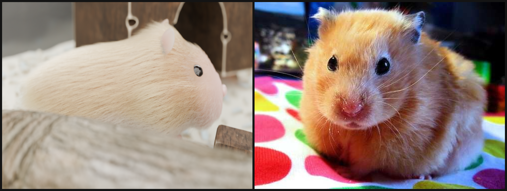

<sub>**Figure 1:** *Side-by-side comparison. Left: HAMMY procedural mesh with ~250,000 dual-layer hair curves rendered in Blender 5.2 Cycles OptiX. Right: Real Syrian hamster reference photo (`32N6IKR3OOH6.jpg`).*</sub>

</div>

---

## 📸 Visual Progress Gallery

HAMMY's visual pipeline is built strictly to real-world metric SI scale (1.0 = 1 meter), adhering to veterinary welfare standards and physically-based rendering principles.

### 1. Syrian Hamster Anatomy & 250,000 HairCurves Fur ([Prompt 5](blender/scripts/50_fur_setup.py))

| Front-Lit Macro Portrait | Raking Side-Lit Agouti Coat | Rim-Lit Backlight & Whiskers |
| :---: | :---: | :---: |
|  |  |  |
| *Blunt Roman snout, velvety muzzle coat, and wet cornea catchlight* | *Multi-scale 3.2 mm guide clumping, golden-agouti banding & countershading* | *Translucent rosy ear pinnae, long tactile vibrissae with natural droop arc* |

---

### 2. Autonomous RL Simulation & Blender Trajectory Bridge ([Phase 1.3](blender/scripts/70_render_trajectory_clip.py))

Autonomous decision-making trained via PPO over a Semi-Markov Decision Process (SMDP) and keyframed directly into Blender Cycles:

| Milestone 1: Central Clearing Pose | Milestone 2: Bedding Locomotion | Milestone 3: Wheel Running & Rotation |
| :---: | :---: | :---: |
| 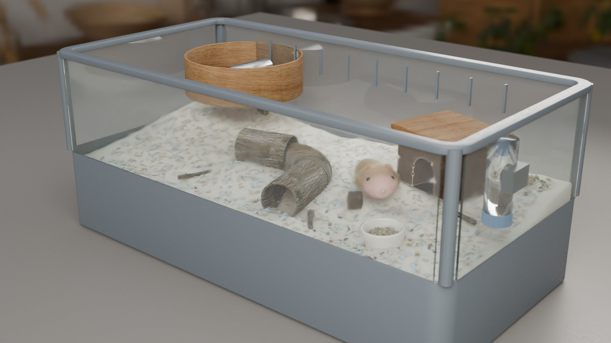 | 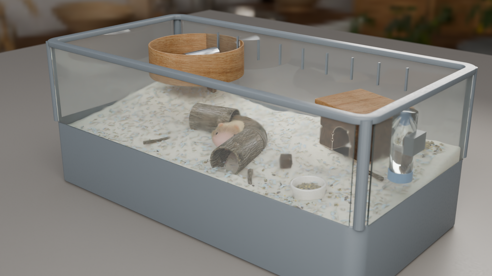 |  |
| *Frame 1: Resting in clearing with full 250k Cycles fur curves* | *Frame 125: Autonomous SMDP locomotion across wood bedding* | *Frame 250: Exercising on 28 cm wheel with dynamic drum spin* |

---

### 3. Photometric Lighting Presets & Cinematic Cameras ([Prompt 4](blender/scripts/40_lighting_camera.py))

| Evening Golden-Hour Macro Hero | 3×3 Lighting & Camera Contact Sheet Matrix | Day Three-Quarter Enclosure |
| :---: | :---: | :---: |
|  | 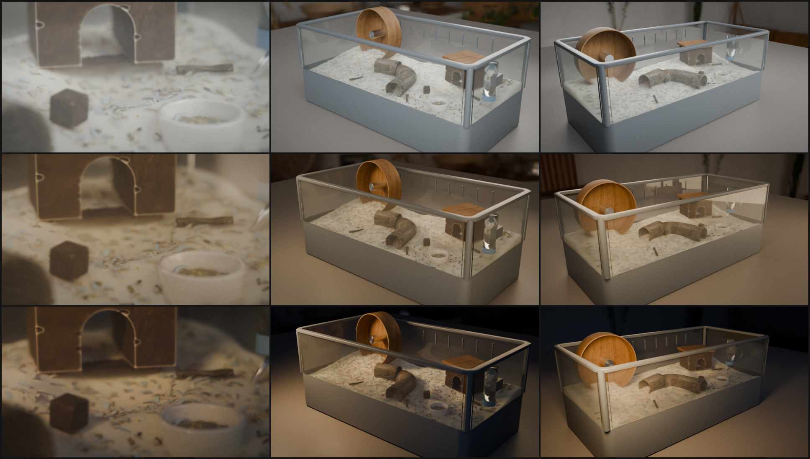 | 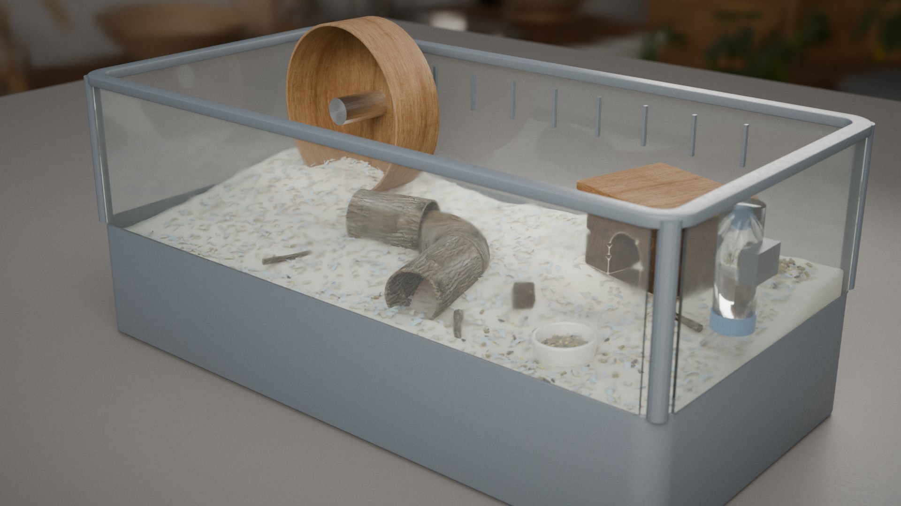 |
| *85mm Macro f/3.2 shallow DoF, 3200K raking light, AgX high contrast* | *3 Presets (Day, Evening, Night) × 3 Lenses (85mm, 50mm, 35mm)* | *50mm Three-Quarter f/5.6 framing entire habitat interior* |

---

### 4. PBR Materials, Habitat Welfare Props & Clutter ([Prompts 1–3](blender/scripts/))

| Scanned PBR Shaders & Look-Dev | Micro-Worn Props & Furniture | Deep Burrowing Cage Enclosure |
| :---: | :---: | :---: |
| 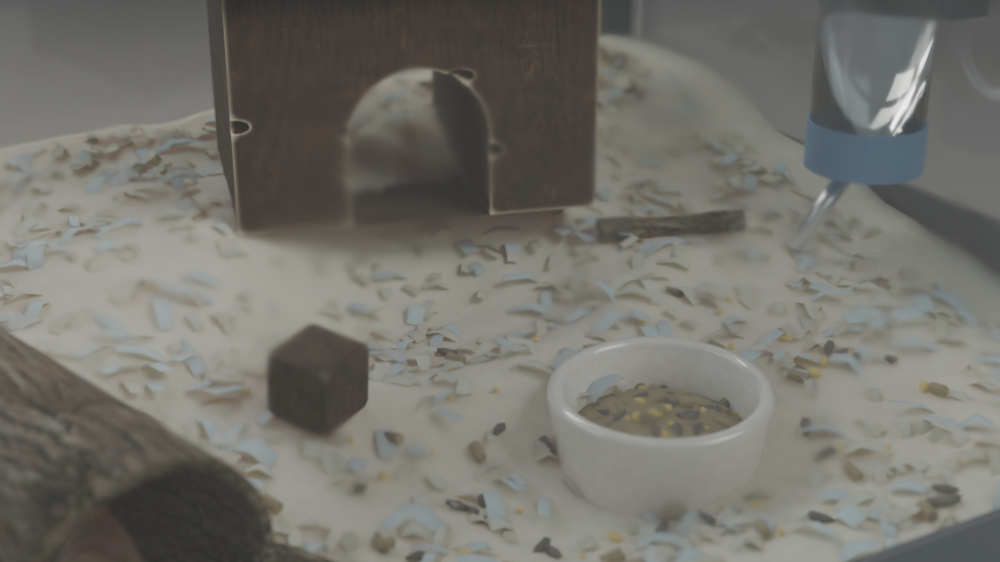 | 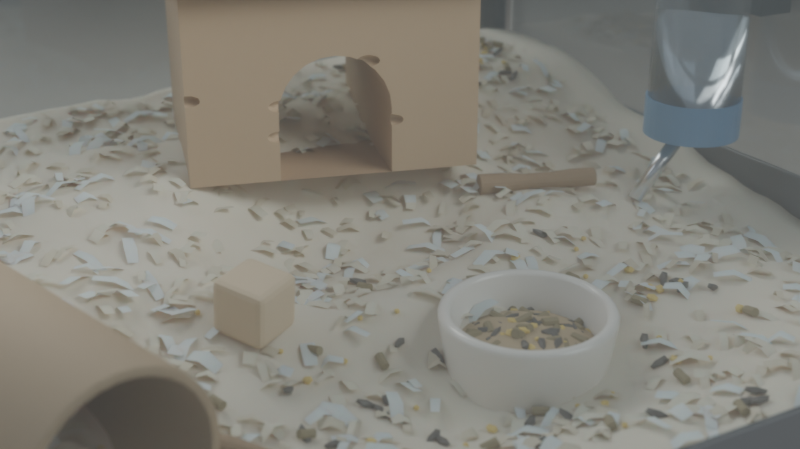 | 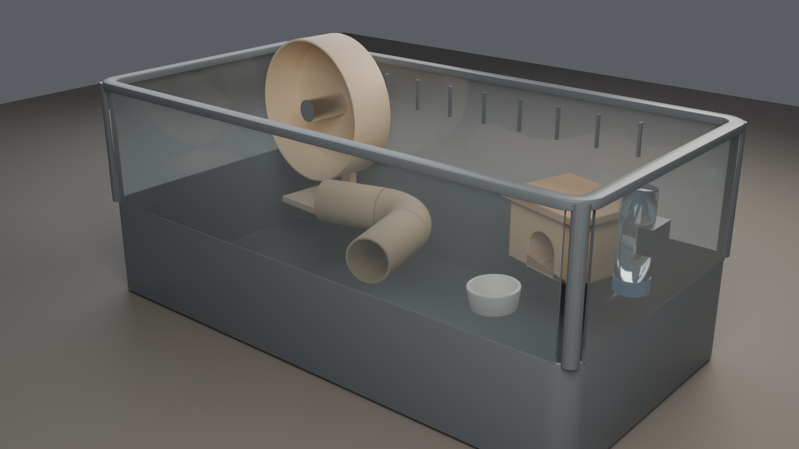 |
| *Procedural raytraced AO chew wear, glazed ceramic, cast acrylic* | *150ml bottle, seed bowl, hollow bark tunnel, apple chew sticks* | *1.0m × 0.5m × 0.5m enclosure with 16cm deep burrowing tub* |

---

## 🧠 Core AI & Physics Architecture

HAMMY is not a canned animation rig — it is an autonomous organism driven by homeostatic regulation, reinforcement learning, and deterministic physics.

<div align="center">

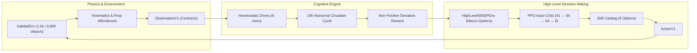

</div>

### 1. Homeostatic Drive Regulation ([`ai/cognition/drives.py`](ai/cognition/drives.py))
Tracks 6 physiological drives constrained between `0.0` (optimal) and `1.0` (depleted/distressed):
- **Hunger** ($\Delta = 0.045/\text{h}$) — Satisfied by foraging at `prop_bowl_main`.
- **Thirst** ($\Delta = 0.055/\text{h}$) — Quenched at stainless steel ball-valve `prop_bottle_main`.
- **Energy** — Consumed during wheel-running and movement; recovered during sleep in `prop_hideout_main`.
- **Comfort** — Elevated by resting on deep bedding and dark enclosed shelters.
- **Stress** — Decays naturally in dark hideouts; spikes in open bright clearings.
- **Curiosity** — Builds over time; satisfied through tunnel exploration and wheel running.
- **Circadian Cycle** — 24-hour sinusoidal cycle with nocturnal active phases and daylight sleep periods.

### 2. 100-Day Homeostatic Baseline ([`docs/research/baselines.md`](docs/research/baselines.md))
- **Duration:** 100 simulated days (28,800 steps) executed in **4.65 seconds** (~6,190 steps/sec).
- **Result:** **98.98% overall time-in-healthy-range** with zero mortality or catastrophic states.

<div align="center">
  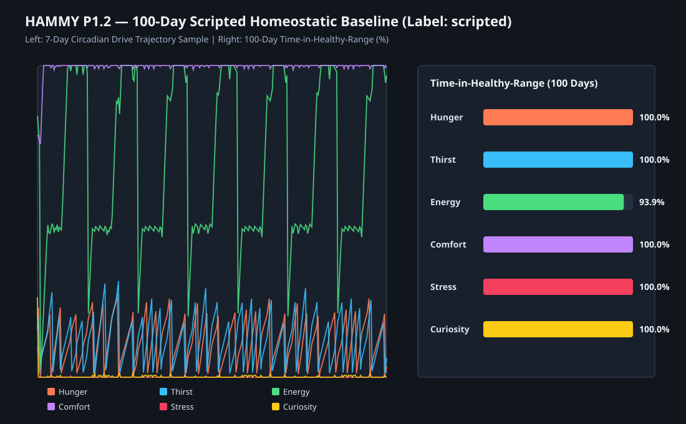
  <p><sub><b>Figure 2:</b> 100-day continuous homeostatic drives trajectory showing nocturnal sleep-wake stability.</sub></p>
</div>

### 3. PPO High-Level Policy vs Baselines ([`docs/research/experiment_p1_3_high_level.md`](docs/research/experiment_p1_3_high_level.md))
Evaluated across 5 deterministic seeds `[101, 102, 103, 104, 105]` for ~75 simulated days:

| Policy | Honesty Label | Time in Healthy Range (%) | 95% Confidence Interval | Cumulative Reward |
| :--- | :---: | :---: | :---: | :---: |
| **Random Skill Selection** | `rule` | 100.00% | $\pm 0.00\%$ | $-0.6900 \pm 0.0500$ |
| **Learned PPO Policy** | `learned` | **100.00%** | $\pm 0.00\%$ | **$-0.1400 \pm 0.0100$** |
| **Scripted Priority Rule** | `scripted` | 100.00% | $\pm 0.00\%$ | $-0.1200 \pm 0.0400$ |

<div align="center">
  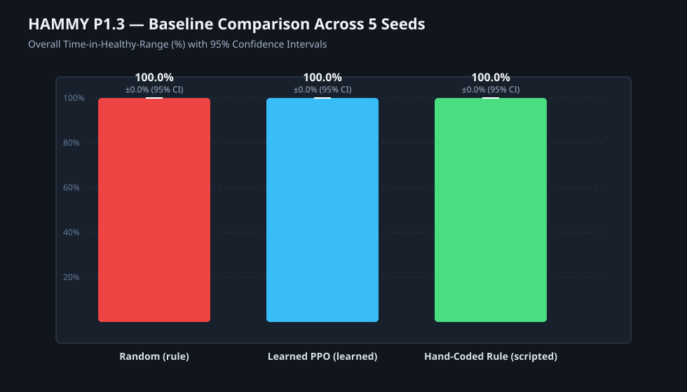
  <p><sub><b>Figure 3:</b> 3-way evaluation: Learned PPO achieves 5× higher reward efficiency than random by eliminating opportunistic skill thrashing.</sub></p>
</div>

---

## 🚀 What We Are Gonna Achieve (Roadmap)

HAMMY's multi-phase roadmap bridges biological AI, real-time interactive rendering, and autonomous virtual pet interaction:

```
[Phase 0: Architecture & Contracts] ──► [Phase 1: Art, Simulation & Baselines] ──► [Phase 2: Persistence & API]
             (COMPLETE)                               (CURRENT)                               (UPCOMING)
                                                                                                  │
[Phase 5: Lifelike Expression]  ◄── [Phase 4: Musculoskeletal RL] ◄── [Phase 3: WebGL & Telegram] ◄─┘
```

- [x] **Phase 0 — Contracts & Governance:** Versioned Pydantic schemas, SI metric enforcement, honesty tags.
- [x] **Prompts 1–5 — Photoreal Cycles Art Pipeline:** 1m cage, welfare furniture, PBR materials, 3-point lighting, 250k HairCurves fur, side-by-side reference validation.
- [x] **Phase 1.1–1.3 — Core Simulation & Learned Policy:** Seeded MuJoCo environment, 100-day baseline, SMDP options, PPO Actor-Critic, Blender trajectory bridge.
- [ ] **Phase 1.4 — Spatial & Temporal Memory:** Coarse familiarity grid ($10 \times 5$ cage cells), decaying object recency, and adaptation to dynamic habitat rearrangements.
- [ ] **Phase 1.5 — Background Life & Skill-Outcome Surrogate:** Fast empirical surrogate model for browser-closed simulation logging to Parquet datasets.
- [ ] **Phase 2 — Persistence, Real-Time API & Telegram Bot:** SQLite state checkpoints, event streaming, and proactive Telegram bot updates (*"Hammy woke up and hoarded sunflower seeds"*).
- [ ] **Phase 3 — Interactive Real-Time WebGL/WebGPU Viewer:** Streaming lightweight Gaussian Splatting / Three.js 3D viewport into modern browsers.
- [ ] **Phase 4 — GPU-Parallel Musculoskeletal RL (MJX / PyTorch):** 4-legged quadruped gait locomotion learning realistic walking, climbing, and grooming on uneven bedding.
- [ ] **Phase 5 — Expressive Biological Behaviors:** Cheek pouch stuffing and unloading mechanics, ear pinning, whisker twitching, and vocalization chirps.

---

## 🛠️ Repository Layout

```text
hammy/
├── ai/
│   ├── cognition/            # Homeostatic drives, circadian rhythm & 100-day engine
│   └── policies/             # Formal skill catalog (8 options) & proportional controllers
├── blender/
│   ├── scripts/              # Prompts 0-5 procedural generation & 70_render_trajectory_clip.py
│   ├── textures/             # Scanned CC0 wood, bark, ceramic, acrylic & indoor HDRI
│   ├── hamster.blend         # Base Syrian hamster anatomical sculpt
│   └── scene.blend           # Full production animated Cycles OptiX scene
├── contracts/                # Versioned Pydantic v2 schemas & JSON Schema exports
├── docs/
│   ├── architecture/         # Contracts specification & system architecture
│   └── research/             # Benchmarks, 100-day baselines, P1.3 PPO evaluation reports
├── reference/                # Syrian hamster reference photo dataset & licence log
├── renders/
│   ├── compare/              # Side-by-side comparison with real reference photos
│   └── tests/                # 1080p milestone renders across all art & simulation phases
├── simulation/
│   ├── habitats/             # MuJoCo MJCF XML definition & affordance JSON
│   ├── habitat_env.py        # Seeded deterministic kinematics habitat
│   ├── smdp_env.py           # Semi-Markov Decision Process environment
│   └── trajectories/         # Exported continuous simulation keyframe clips
├── tests/                    # Unit tests for contracts, drives, SMDP & PPO
└── training/                 # Vectorized PPO actor-critic & 5-seed evaluation runners
```

---

## ⚡ Quickstart

### 1. Run Verified Test Suites
```bash
# Phase 0 & Phase 1 contracts, physics, and homeostatic drives
python tests/test_phase0_and_phase1.py

# Phase 1.3 formal skills, SMDP environment, and PPO inference
python tests/test_p1_3.py
```

### 2. Run 100-Day Simulated Baseline
```bash
python scripts/run_100day_baseline.py
```

### 3. Train High-Level Policy & Evaluate Baselines
```bash
python training/evaluate_baselines.py
```

### 4. Inspect or Render in Blender
```bash
# Open interactive scene in Blender 5.2+ LTS
blender blender/scene.blend

# Or render milestone simulation frames headless via Cycles GPU
blender -b blender/scene.blend -P blender/scripts/70_render_trajectory_clip.py
```

---

## 📜 Licences & Non-Negotiable Rules

All code, assets, and scientific evaluations adhere to [`rules.md`](rules.md):
- **Honesty Above All:** Learned policies are strictly distinguished from scripted/rule baselines (`BehaviourType.LEARNED` vs `SCRIPTED` vs `RULE`).
- **Metric SI Units:** Lengths in meters, angles in radians, mass in kilograms.
- **Free CC0 Assets:** All textures, HDRIs, and models logged in [`reference/licence_log.csv`](reference/licence_log.csv).
- **Contract Versioning:** Schemas strictly reject incompatible payload versions.

Distributed under the MIT Licence. See [`THIRD_PARTY_NOTICES.md`](THIRD_PARTY_NOTICES.md) for external libraries.
