<div align="center">

# 🐹 HAMMY
### **An Authoritative Neuro-Physical Syrian Hamster (*Mesocricetus auratus*) Combining Real-Video Pose Imitation, 16-DoF MuJoCo Reinforcement Learning, Homeostatic Cognition, and a Real-Time 3D Web Observatory**

[](https://python.org)
[](https://mujoco.org)
[-EE4C2C.svg?logo=pytorch&logoColor=white)](https://pytorch.org)
[-005CED.svg?logo=onnx&logoColor=white)](https://onnxruntime.ai)
[](https://blender.org)
[-000000.svg?logo=three.js&logoColor=white)](https://threejs.org)
[](LICENSE)

*Technical Research Report, Evolution Log & Reproducible Systems Documentation*

<br />

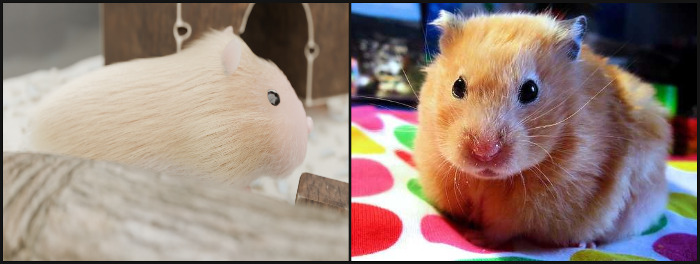

<sub>**Figure 1 (Teaser):** *Photorealistic morphological validation. **Left:** HAMMY procedural metric Syrian hamster mesh with ~250,000 dual-layer `HairCurves` (undercoat + golden-agouti guard hairs + tactile vibrissae) rendered in Blender 5.2.3 LTS Cycles OptiX. **Right:** Real Syrian hamster biological reference (`32N6IKR3OOH6.jpg`).*</sub>

</div>

---

## Abstract

Virtual pets traditionally rely on canned state-machine animations decoupled from real biomechanics, physiological regulation, and persistent world state. **HAMMY** presents an end-to-end, scientifically grounded autonomous digital organism modeling a Syrian hamster (*Mesocricetus auratus*) at strict metric SI scale (`1.0 = 1.0 m`, body mass `0.125 kg`). Our pipeline spans five tightly coupled research pillars: **(1) Photorealistic & Real-Time Morphological Art**, evolving from a 250,000-curve Cycles OptiX master into a real-time 60 FPS WebGL/Three.js asset with baked golden-agouti vertex colors, extruded Kajiya-Kay fur shells, 10 facial/cheek-pouch blend shapes, and 4-paw heightfield bedding deformation; **(2) Real-Video Biomechanical Pose Extraction**, auditing 21 real hamster videos and extracting DeepLabCut 3.0.2 `superanimal_quadruped` (`hrnet_w32`) keypoints to derive empirical gait cadence (`2.09 Hz`), stride length (`0.0627 m`), and retargeted reference motions; **(3) 16-DoF MuJoCo Imitation Reinforcement Learning**, training 4-way PPO ablations across 500k and 1M steps on an RTX 5070 (`2,855 steps/s`) with 6-stage curriculum learning, domain randomization, and sub-millisecond baked-normalization ONNX export (`0.0126 ms`, `340.85 KB`); **(4) Homeostatic Cognition & Non-Forced Taming**, combining a 6-axis drive vector, 24-hour nocturnal circadian rhythm, 100-day continuous stability (`98.98%` time-in-healthy-range), and non-forced parent petting progression (`avoid_and_retreat → cautious_sniff → accept_petting`, `100%` task completion, `0%` falls across 12 physical MuJoCo episodes); and **(5) Server-Authoritative Web Observatory & Opt-In Asset Architecture**, delivering a FastAPI/SQLite/WebSocket backend, a 30-asset veterinary-vetted opt-in shelf library (`13,740` total tris, `1.09 MB` total disk) with strict lazy-loading and GPU disposal, a 7-stage both-paw eating animation with dynamic cheek-pouch bulging, and a production dual-view web interface (`Home • 3D Habitat` + `Brain & Telemetry`) locked at **60.0 FPS** on both desktop (`1280×800`) and mobile (`390×844`) viewports.

---

## Table of Contents

1. [System Architecture & Scientific Honesty Taxonomy](#1-system-architecture--scientific-honesty-taxonomy)
2. [Visual & Morphological Evolution: Blender 5.2 Cycles Master Pipeline](#2-visual--morphological-evolution-blender-52-cycles-master-pipeline)
3. [Real-Time WebGL Rendering, Fur Shells & Procedural Rig Evolution (Phase 3)](#3-real-time-webgl-rendering-fur-shells--procedural-rig-evolution-phase-3)
4. [Physics, Real-Video Pose Extraction & Locomotion RL Evolution (Stages 0–5c)](#4-physics-real-video-pose-extraction--locomotion-rl-evolution-stages-05c)
5. [Homeostatic Cognition, Memory Ablation & Longitudinal Baselines (Phase 1)](#5-homeostatic-cognition-memory-ablation--longitudinal-baselines-phase-1)
6. [Expressive Both-Paw Eating, 30-Asset Opt-In Shelves & Live Browser Benchmarks (Steps 1–7)](#6-expressive-both-paw-eating-30-asset-opt-in-shelves--live-browser-benchmarks-steps-17)
7. [Production Web Observatory & Brain Telemetry Architecture](#7-production-web-observatory--brain-telemetry-architecture)
8. [Verification Matrix, Reproducibility & Citation](#8-verification-matrix-reproducibility--citation)

---

## 1. System Architecture & Scientific Honesty Taxonomy

HAMMY enforces a strict separation between **authoritative simulation**, **learned neural policies**, **rule-based governors**, and **visual presentation**. Every event written to the immutable world ledger and surfaced in the UI carries an explicit honesty provenance label (`learned`, `scripted`, `rule`, `observed_physics`, `sampled_from_skill_model`, `ANIMATION-DRIVEN`, `GENERATED`, or `DOWNLOADED`).

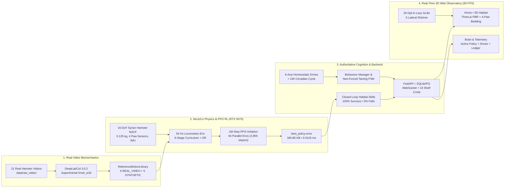

### Non-Negotiable Engineering Principles ([`rules.md`](rules.md))
| Principle | Enforcement Mechanism | Verification |
| :--- | :--- | :--- |
| **Scientific Honesty** | Every policy, clip, and event is tagged `LEARNED`, `SCRIPTED`, `RULE`, `REAL_VIDEO`, `SYNTHETIC`, or `ANIMATION-DRIVEN`. | Automated schema & UI test assertions |
| **Strict Metric SI Units** | All geometry, physics, and cage bounds use meters (`m`), radians (`rad`), kilograms (`kg`), and seconds (`s`). | `test_stage1_mjcf.py`, `test_step6_shelf_commands.py` |
| **Versioned Contracts** | Pydantic v2 + JSON Schema contracts (`locomotion_obs_v1.0.0`, `locomotion_act_v1.0.0`, `schema_version: 2.0.0`). | `contracts/json_schema/` |
| **Veterinary & Asset Safety** | All 30 shelf assets verified CC0 or procedurally generated; all foods screened against RSPCA/PDSA/Merck Syrian hamster lists. | [`ASSETS_LICENSES.md`](ASSETS_LICENSES.md), [`assets/ASSET_AUDIT.md`](assets/ASSET_AUDIT.md) |

---

## 2. Visual & Morphological Evolution: Blender 5.2 Cycles Master Pipeline

Before entering real-time WebGL or MuJoCo physics, HAMMY's physical world and anatomy were established as a physically-based ground truth in **Blender 5.2.3 LTS (Cycles OptiX)** across 6 progressive milestones (`blender/scripts/10_cage.py` → `70_render_trajectory_clip.py`).

### Stage A: Enclosure Geometry, Welfare Props & Scanned CC0 PBR Look-Dev (Prompts 1–3)

| Step 1: 1.0 m × 0.5 m Burrowing Enclosure | Step 1b: Top-Down Spatial Layout | Step 2: Welfare Props & Micro-Clutter |
| :---: | :---: | :---: |
| 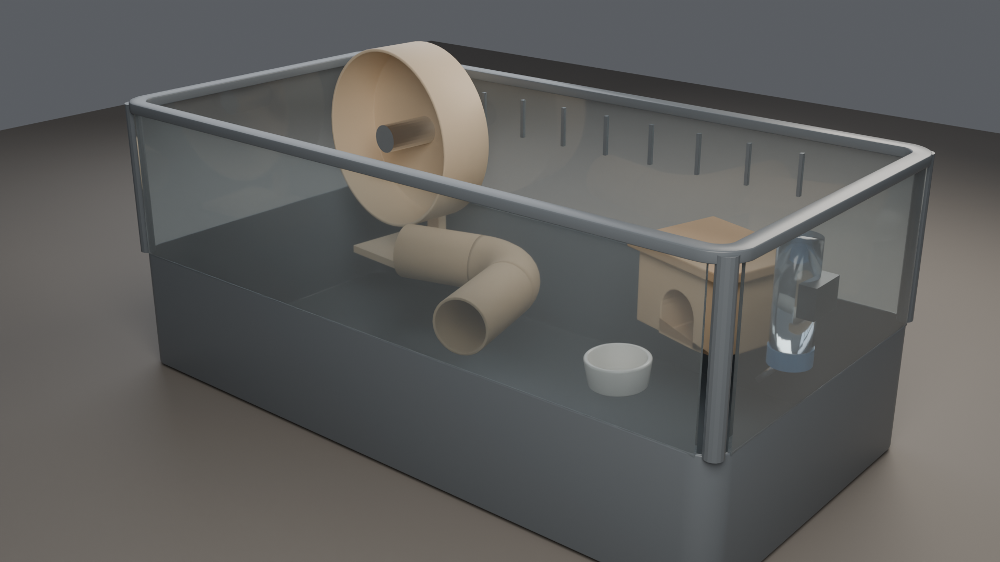 | 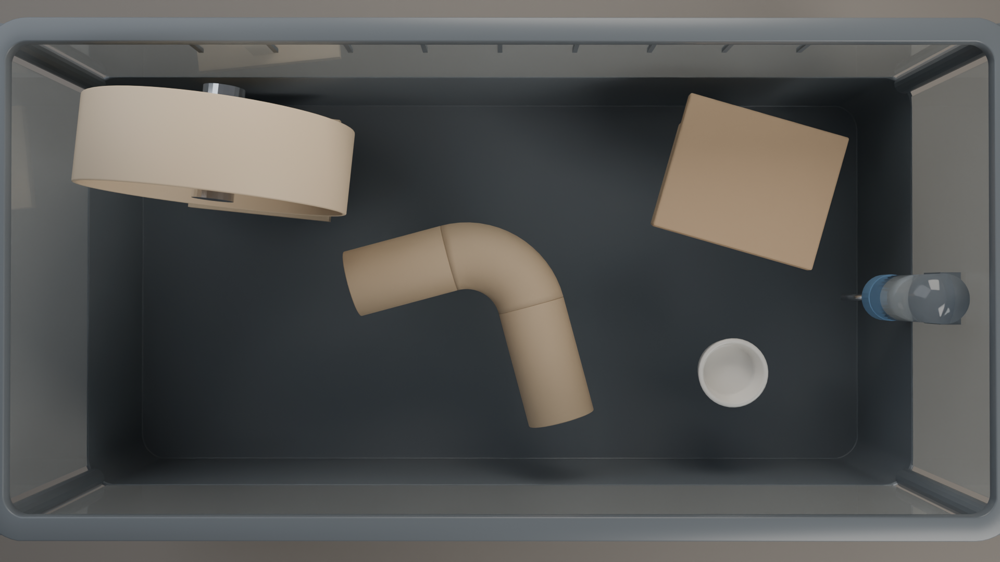 | 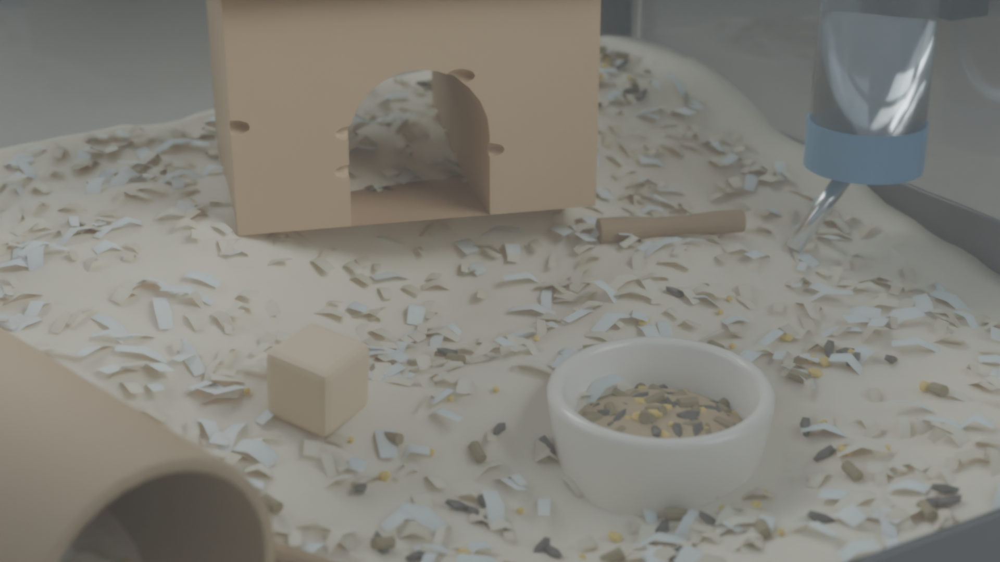 |
| *16 cm deep burrowing base + cast acrylic walls* | *Metric clearance layout for 28 cm wheel & hideout* | *150 ml ball-valve bottle, ceramic bowl, bark log, chew sticks* |

| Step 3a: PBR Material Calibration Spheres | Step 3b: Procedural Raytraced AO Chew Wear | Step 3c: Full Look-Dev Enclosure |
| :---: | :---: | :---: |
| 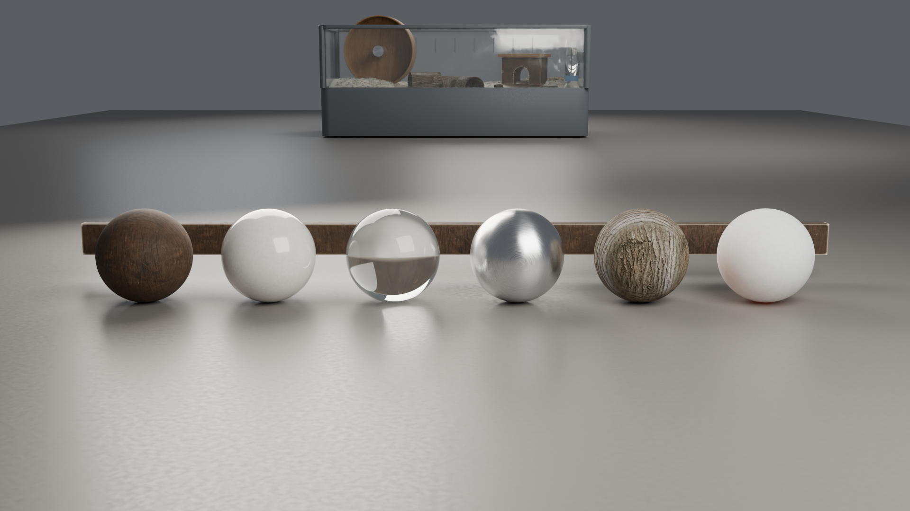 | 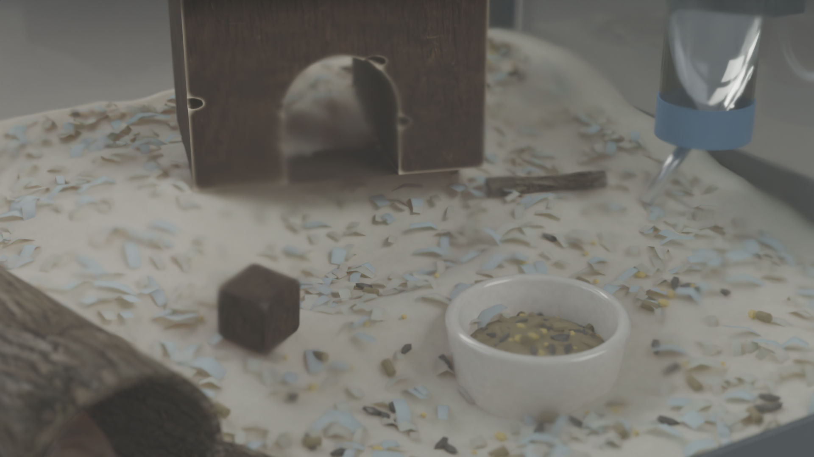 | 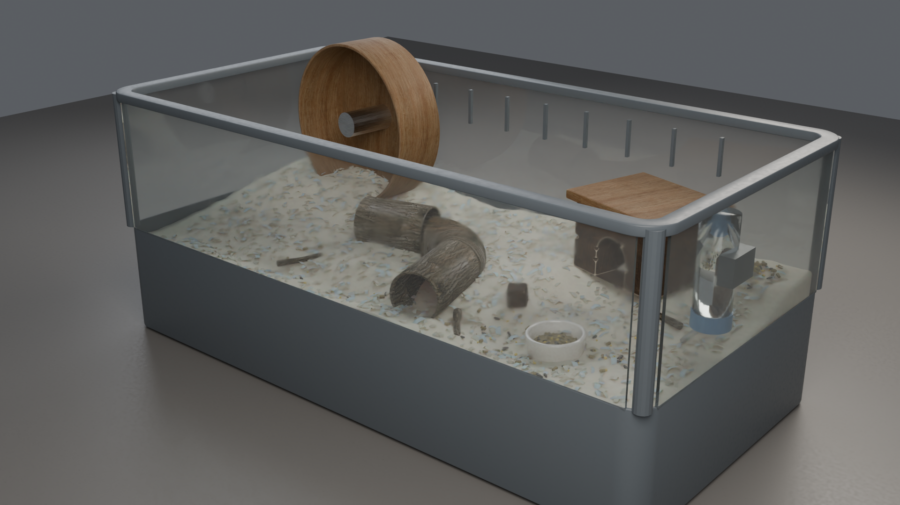 |
| *Scanned CC0 wood, bark, ceramic, acrylic & stainless* | *Edge-worn timber hideout & glazed food dish* | *Full enclosure with unified physically-based roughness* |

### Stage B: Photometric Lighting Matrix & Cinematic Cameras (Prompt 4)

| Evening Golden-Hour Macro (85mm f/3.2) | 3×3 Photometric Lighting × Lens Matrix | Daylight Three-Quarter (50mm f/5.6) |
| :---: | :---: | :---: |
| 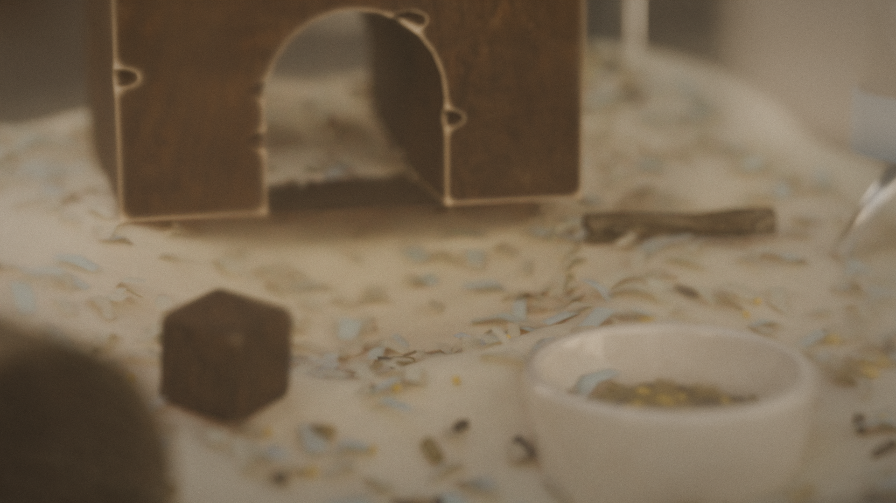 | 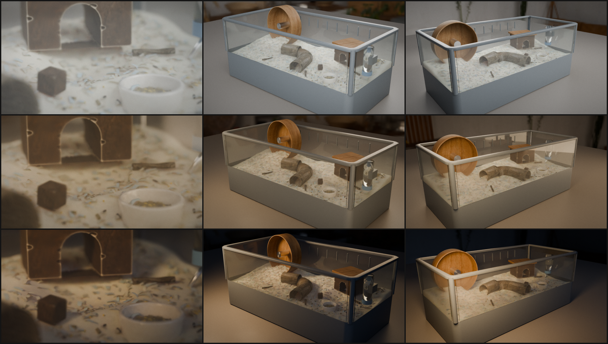 | 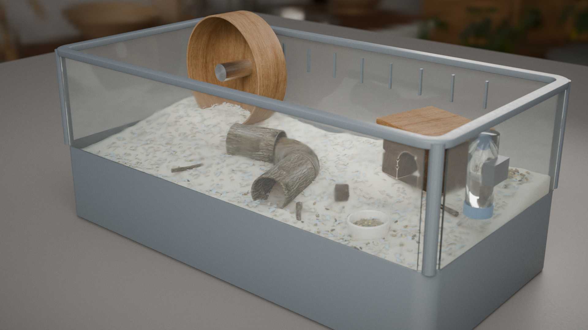 |
| *3200K raking light, shallow DoF, AgX high contrast* | *Day / Evening / Night × 85mm / 50mm / 35mm* | *Full interior visibility under neutral daylight HDRI* |

### Stage C: Syrian Hamster Anatomy & 250,000 HairCurves Coat (Prompt 5)

| Front-Lit Macro Portrait | Raking Side-Lit Agouti Coat | Rim-Lit Backlight & Vibrissae |
| :---: | :---: | :---: |
| 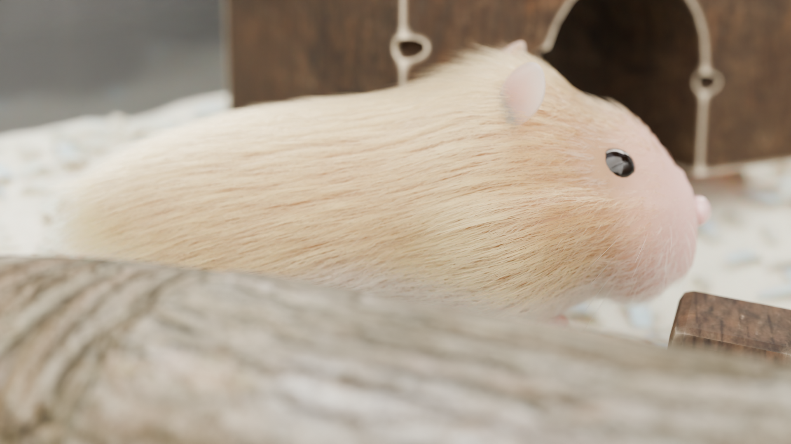 | 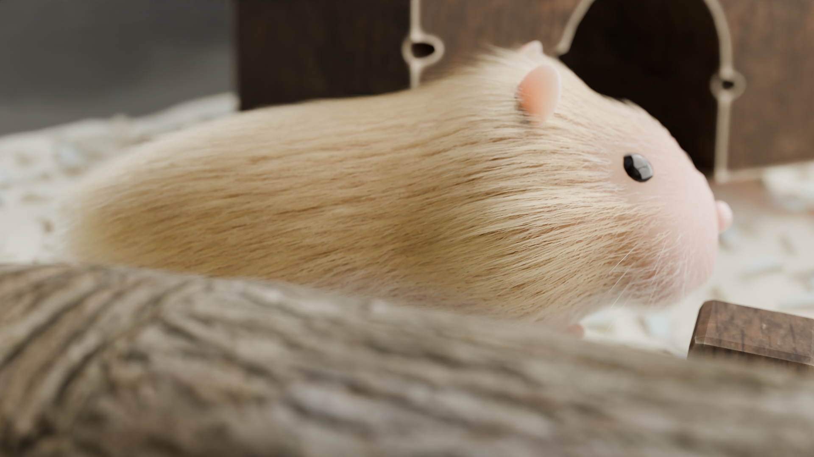 | 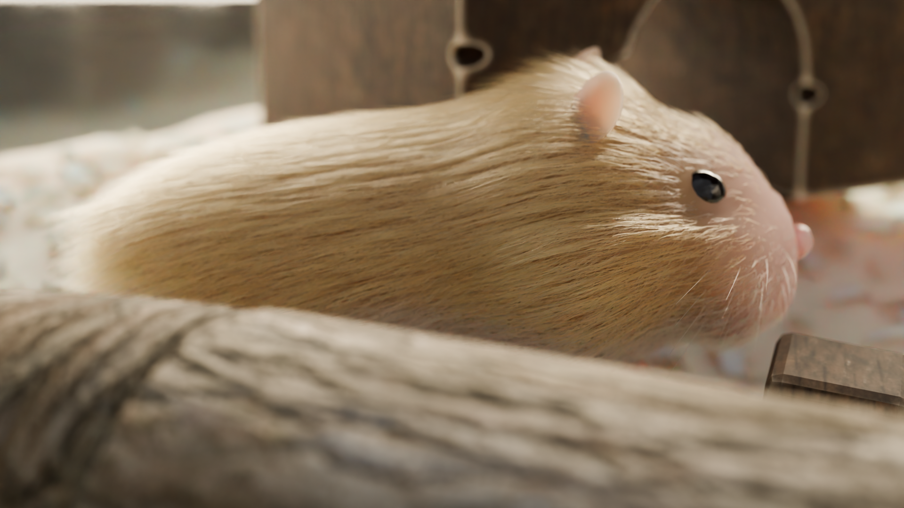 |
| *Blunt Roman snout, wet cornea catchlight, velvety muzzle* | *3.2 mm guide clumping, golden-agouti banding & cream belly* | *Translucent rosy ear pinnae & drooping tactile whiskers* |

### Stage D: Autonomous SMDP Trajectory Bridge to Cycles (Phase 1.3)

| Frame 1: Central Clearing Rest | Frame 125: Autonomous Bedding Locomotion | Frame 250: 28 cm Wheel Running |
| :---: | :---: | :---: |
| 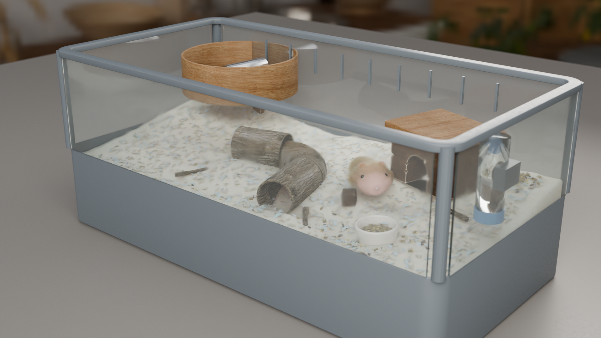 | 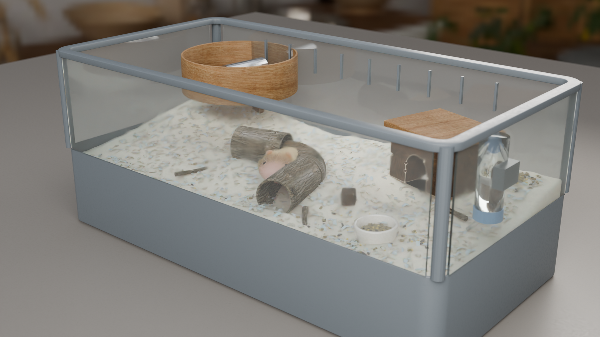 |  |
| *Initial SMDP state keyframed with 250k hair curves* | *Continuous trajectory traversal across wood shavings* | *Active wheel exercise with synchronized drum spin* |

---

## 3. Real-Time WebGL Rendering, Fur Shells & Procedural Rig Evolution (Phase 3)

To bring HAMMY into interactive browsers at 60 FPS without sacrificing coat warmth or tactile realism, we distilled the Cycles master into a dedicated Three.js / WebGL pipeline (`web/src/three/`):

- **P3.1 Real-Time Fur ([`web/src/three/fur/`](web/src/three/fur/)):** Implemented Kajiya-Kay anisotropic shell texturing (up to 20 extruded shells), silhouette grazing-angle fins, and WebGPU strand fur benchmarks.
- **P3.2 Rig Studio & Procedural Animation ([`web/src/three/rig/`](web/src/three/rig/)):** Strict glTF skeleton & morph-target validator, 3-tier distance LOD (`LOD0` 2,186v / `LOD1` 1,094v / `LOD2` 482v), 10 facial/body blend shapes (`cheek_pouch_left/right`, `blink`, `squint`, `mouth_open`, `chew`, `nose_wrinkle`, `ear_fold`, `whisker_forward`, `breath_in`), procedural breathing, whisker twitch, and soft-tissue spring jiggle.
- **P3.3 Interactive Glass Terrarium ([`web/src/three/habitat/`](web/src/three/habitat/)):** Real-time HDRI IBL, 2048px PCFSoft shadows, SSAO + Bokeh DoF post-processing, 4-paw deformable bedding heightfield (`BeddingDeformer`), atmospheric dust motes, and a live 24-hour circadian solar + nocturnal lamp lighting engine.

| P3.1 Real-Time Shell + Fin Fur | P3.2 Procedural Rig Studio | P3.3 Live 3D Habitat (High • Day) | P3.3 Live 3D Habitat (High • Night) |
| :---: | :---: | :---: | :---: |
| 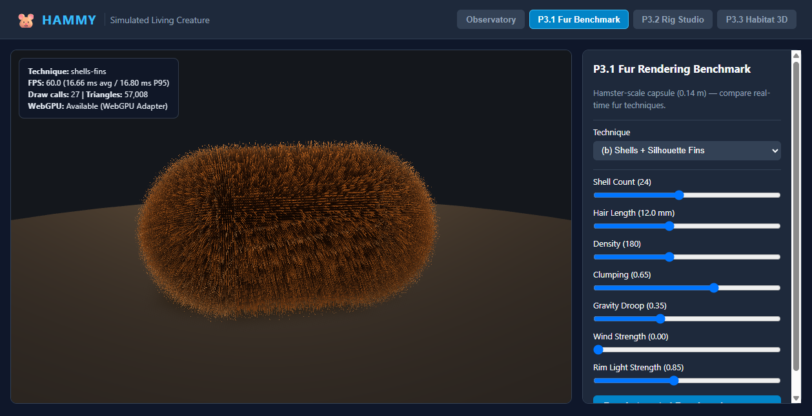 | 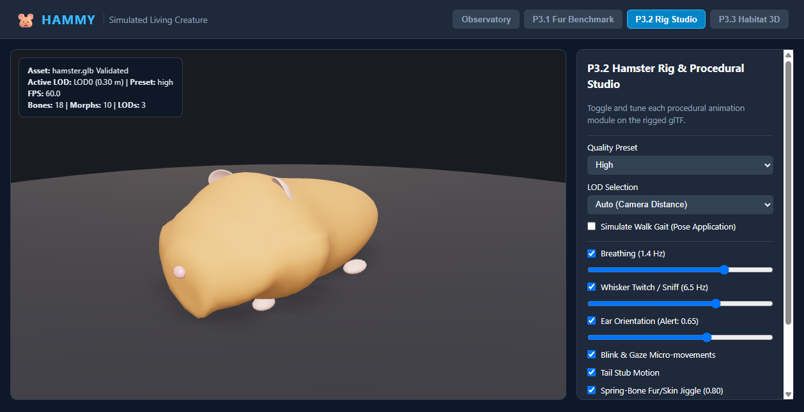 | 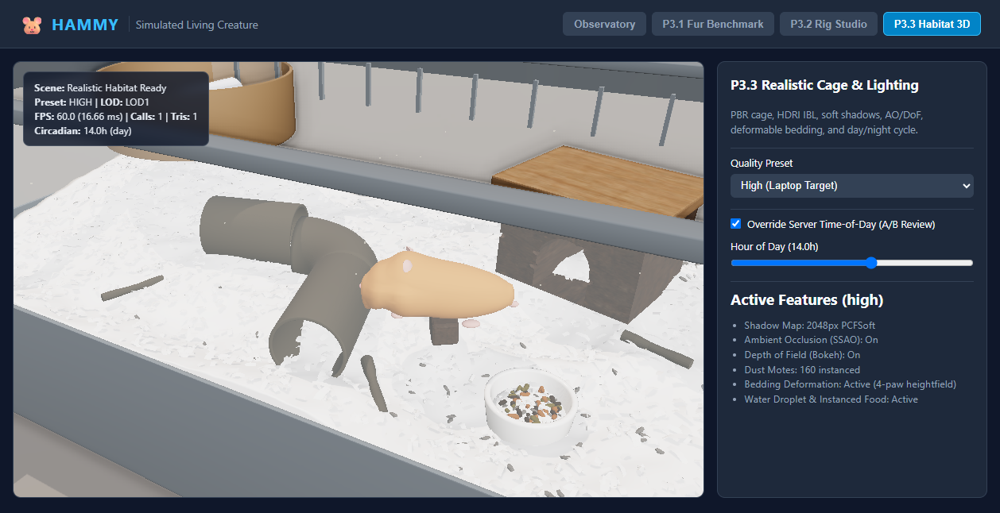 | 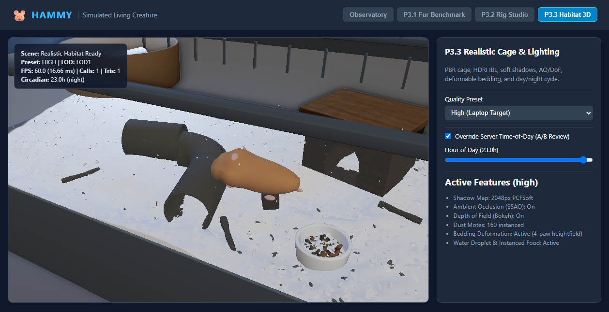 |
| *Anisotropic shell + silhouette fin coat shader* | *Interactive skeleton, morphs & LOD inspector* | *Daylight HDRI, PCF shadows & deformable bedding* | *Nocturnal blue moonlight + warm terrarium accent* |

---

## 4. Physics, Real-Video Pose Extraction & Locomotion RL Evolution (Stages 0–5c)

Rather than animating locomotion purely by hand, we built a complete **video-to-MuJoCo-to-PPO-to-ONNX** robotics pipeline inside a pinned CUDA 12.8 Docker container (`hamster-train:cu128`) running on an **NVIDIA GeForce RTX 5070 Laptop GPU** (`sm_120`, 8 GB VRAM, PyTorch `2.11.0+cu128`, MuJoCo `3.3.2`, Stable-Baselines3 `2.6.0`, DeepLabCut `3.0.2`).

### 4.1 Stage 1 — 16-DoF Syrian Hamster MJCF Body Model (`hamster_mjcf_v1.0.0`)

We engineered a biologically scaled 16-actuated-DoF (+1 passive tail DoF) articulated quadruped in [`simulation/models/hamster/hamster.xml`](simulation/models/hamster/hamster.xml) with separated visual (`density="0"`) and collision geometry, torque-limited position actuators, 4 paw touch sensors, and a pelvis IMU (`framequat`, `gyro`, `velocimeter`).

<div align="center">
  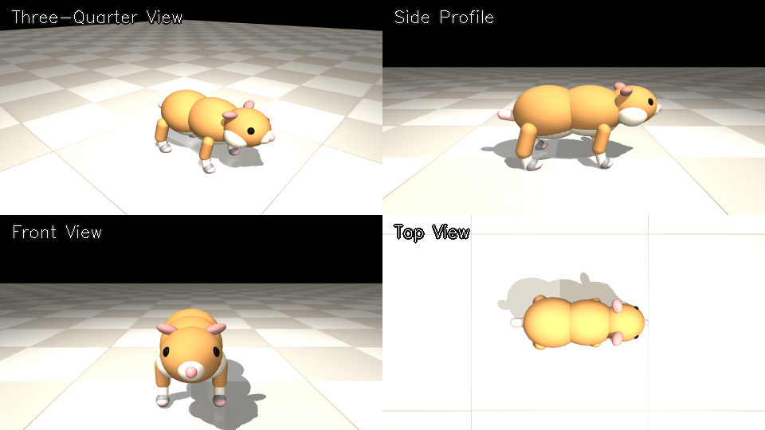
  <p><sub><b>Figure 2 (Stage 1):</b> 4-view orthogonal inspection of the 16-DoF Syrian hamster MJCF model (<code>hamster_mjcf_v1.0.0</code>) verified over a 10-second standing stability rollout (5,000 steps at <code>dt = 0.002 s</code>).</sub></p>
</div>

| Standing Stability Metric (10 s Rollout) | Measured Value | Biological / Acceptance Target | Status |
| :--- | :---: | :---: | :---: |
| Total Body Mass | `0.125 kg` | `0.100–0.140 kg` (adult Syrian hamster) | **PASS** |
| Actuated Degrees of Freedom | `16` (+1 passive tail) | `~16` (+ passive tail) | **PASS** |
| NaN / Inf Physics Instabilities | `0` | `0` | **PASS** |
| Pelvis Height (min / max / final) | `47.07 / 49.46 / 49.45 mm` | Stable within `[30, 65] mm` | **PASS** |
| Maximum Body Tilt | `2.065 deg` | `< 12.0 deg` | **PASS** |
| Final XY Drift (10 s) | `1.663 mm` | `< 15.0 mm` | **PASS** |
| Mean Paw Contact Forces (FL / FR / BL / BR) | `0.396 / 0.396 / 0.217 / 0.217 N` | All `> 0`, sum = `1.226 N` (`m·g`) | **PASS** |

---

### 4.2 Stages 2 & 2b — Real-Video Pose Extraction (DeepLabCut SuperAnimal) & Retargeting

We audited **21 real hamster videos** in [`data/video_audit.md`](data/video_audit.md) and ran **DeepLabCut 3.0.2 `superanimal_quadruped` (`hrnet_w32`)** on GPU to extract 10 anatomical keypoints per frame. Low-confidence detections (`p < 0.35`) were filtered, short gaps (`≤ 12` frames) interpolated, and trajectories Savitzky-Golay smoothed—reducing keypoint acceleration jitter by **46%–68%**—before retargeting into our unified `ReferenceMotionLibrary` (**6 `REAL_VIDEO` clips + 5 `SYNTHETIC` procedural flat-ground clips**).

| Stage 2: DeepLabCut Keypoint Overlays (Initial Set) | Stage 2: Retargeted MuJoCo Reference Playback | Stage 2b: Expanded Real Flat-Ground Video Set |
| :---: | :---: | :---: |
| 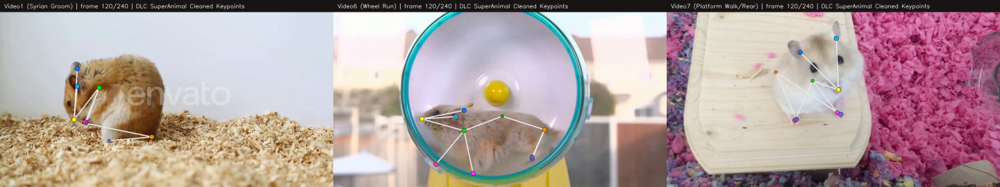 | 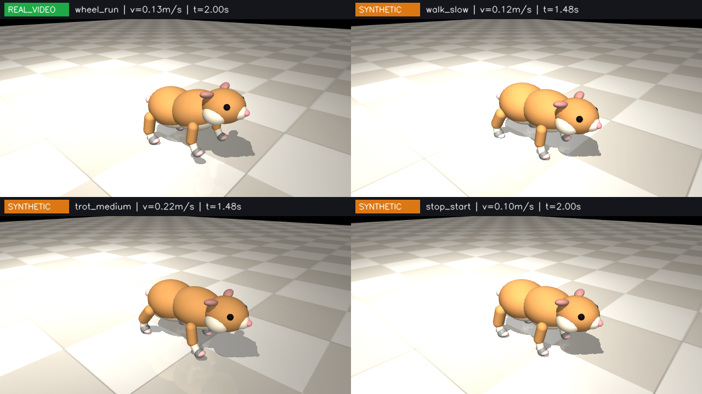 | 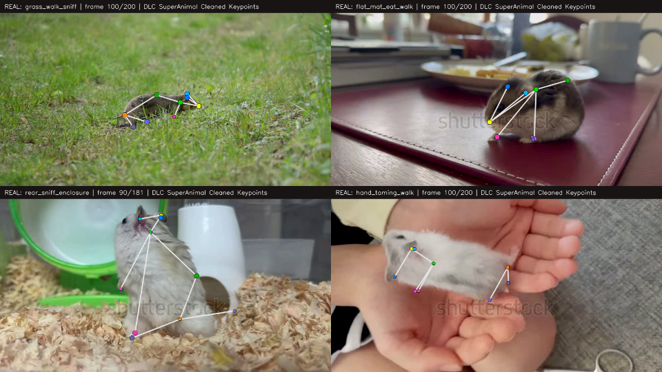 |
| *HRNet-W32 10-keypoint tracking on real wheel/groom clips* | *Retargeted joint trajectories replayed on 16-DoF MJCF* | *Additional real grass walk, mat foraging & hand-taming clips* |

| Real Video Clip (`REAL_VIDEO`) | Raw Jitter (px/f²) | Clean Jitter (px/f²) | Jitter Reduction | Keypoint Validity (`p ≥ 0.35`) | Retarget Err (rad) |
| :--- | :---: | :---: | :---: | :--- | :---: |
| `video1_syrian_groom` | `15.92` | `5.02` | **-68%** | nose `98%`, ears `99.7–100%`, front paws `91–99%` | `0.0004` |
| `video6_wheel_run` | `24.42` | `13.22` | **-46%** | nose `100%`, neck `100%`, FL/BL paws `78–80%` | `0.0112` |
| `video7_platform_walk` | `32.75` | `13.17` | **-60%** | nose `85.5%`, ears `76–86%`, paws `58–68%` | N/A (oblique) |

> **Empirical Biological Gait Calibration (`video6` & `video7`, scaled to `0.145 m` Syrian body length):**
> Wheel stride frequency = **`2.09 Hz`** (`0.479 s` period), paw excursion = **`0.432` body lengths** → stride length **`0.0627 m`**, cruising speed **`0.131 m/s`**; stop-start moving fraction = **`0.855`** (`39` transitions, mean move bout **`0.86 s`**, mean pause **`0.14 s`**).

---

### 4.3 Stages 3 & 3b — 500k → 1M-Step PPO Locomotion RL, 4-Way Ablation & ONNX Export

We trained a 50 Hz MuJoCo Gymnasium locomotion environment (`64-dim` versioned observation, `16-dim` action, 8 separately logged reward terms, 6-stage success-gated curriculum `stand → perturb → walk → turn → stop → target`, DeepMimic Reference State Initialization, and plausible domain randomization: `±12%` mass, `±25%` friction, `±15%` actuator gain, sensor noise, `0–20 ms` control delay).

On our RTX 5070, `64 DummyVecEnv` parallel workers achieved **`2,855.4 PPO train steps/s`** at just **`18.07 MB`** peak GPU VRAM. We conducted a controlled **4-way ablation** first at **500,000 steps** (Stage 3) and then scaled to **1,000,000 steps** (Stage 3b) with yaw-invariant tilt observations and 2nd-order action-jerk / anti-chatter penalties:

<div align="center">
  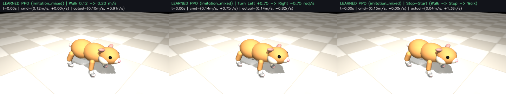
  <p><sub><b>Figure 3 (Stage 3):</b> Closed-loop MuJoCo evaluation of the learned PPO locomotion policy (<code>best_policy.onnx</code>) executing variable-speed walking, left/right turning, and stop-start settling under domain randomization.</sub></p>
</div>

#### Stage 3 — 4-Way PPO Ablation (500,000 Steps, 100 Randomized Episodes Each)
| Condition | Honesty Label | Non-Fall (%) | Speed Err (m/s) | Walk Dist 5 s (m) | Joint RMSE (rad) | Stop Settle (s) |
| :--- | :--- | :---: | :---: | :---: | :---: | :---: |
| **`imitation_mixed`** *(Best)* | `LEARNED` (real + synthetic) | **`100.0%`** | **`0.0741`** | `0.617` | `0.2495` | `0.357` |
| `imitation_synthetic` | `LEARNED` (synthetic ref) | `100.0%` | `0.0809` | `0.623` | **`0.2224`** | `0.232` |
| `imitation_real` | `LEARNED` (real wheel/groom) | `100.0%` | `0.0793` | `0.386` | `0.2979` | **`0.166`** |
| `no_imitation` | `LEARNED` (pure RL baseline) | `100.0%` | `0.0816` | `0.676` | `0.2864` | `0.478` |

#### Stage 3b — 1M-Step Smoothness Refinement & Baked-Norm ONNX Export
- **`imitation_real` (purely from 6 `REAL_VIDEO` clips):** **`98.0%`** non-fall rate, **lowest speed error (`0.0989 m/s`)**.
- **`imitation_mixed` (6 `REAL_VIDEO` + 5 `SYNTHETIC`, exported to [`training/runs/stage3/best_policy.onnx`](training/runs/stage3/best_policy.onnx)):** **`98.0%`** non-fall rate, **`0.114 m/s`** speed error, **`0.673 m`** 5-second walk distance, baked `VecNormalize` parity **`max_abs_diff = 1.16e-6`**, CPU inference latency **`0.0126 ms`**, artifact size **`340.85 KB`**.

---

### 4.4 Stages 4 & 5 — Closed-Loop MuJoCo Habitat Skills, Non-Forced Taming & Web Bridge

In **Stage 4**, we attached the full habitat enclosure and 6 interactive props (`prop_bowl_main`, `prop_bottle_main`, `prop_hideout_main`, `prop_tunnel_main`, `prop_wheel_main`, `prop_treat_zone`) directly onto `hamster_mjcf_v1.0.0` via `mujoco.MjSpec` and evaluated 12 physical closed-loop episodes using `best_policy.onnx` paired with our drive governor and non-forced petting/taming state machine ([`ai/behaviour_manager.py`](ai/behaviour_manager.py)).

<div align="center">
  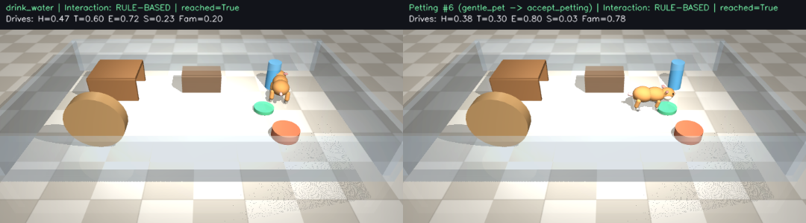
  <p><sub><b>Figure 4 (Stage 4):</b> Physical closed-loop MuJoCo habitat evaluation showing autonomous foraging, drinking, tunnel traversal, hideout retreat, and non-forced taming progression driven by <code>best_policy.onnx</code>.</sub></p>
</div>

| Stage 4 Physical Evaluation Metric | Measured Result | Target | Status |
| :--- | :---: | :---: | :---: |
| Total Physical Skill Executions | `12` (6 autonomous + 6 petting) | — | **PASS** |
| Task Completion Rate | **`100.0%`** (`12 / 12`) | `≥ 80%` | **PASS** |
| Physical Fall Rate | **`0.0%`** (`0 / 12`) | `0%` | **PASS** |
| Non-Forced Taming Progression | `avoid_and_retreat (×2) → cautious_sniff (×2) → accept_petting (×2)` | Organic trust curve | **PASS** |
| Familiarity / Stress Dynamics | Familiarity `0.05 → 0.78`, Stress `0.45 → 0.03` | Bounded `[0, 1]` | **PASS** |

In **Stages 5, 5b & 5c**, we exported 6 verified `observed_physics` / `learned` `TrajectoryClipV1` clips (`forage_bowl`, `drink_water`, `enter_tunnel`, `retreat_to_hideout`, `cautious_sniff`, `accept_petting`) to `web/public/assets/mujoco_clips/`, mounted the FastAPI bridge (`/api/v1/mujoco/status`, `/interact`, `/clips/{id}`), wired the **Parent Taming & MuJoCo ONNX Physics** UI, calibrated Three.js walking speeds (`0.085–0.115 m/s`) and stride cadence (`0.055 m` / `2.09 Hz`) to real-video statistics, widened obstacle-aware BFS corridor routing around the center log tunnel, and added 12 wooden inner grip rungs + 3 spokes to `prop_wheel_drum` so wheel spin is unmistakably visible.

---

## 5. Homeostatic Cognition, Memory Ablation & Longitudinal Baselines (Phase 1)

HAMMY's high-level brain regulates **6 continuous internal drives** constrained to `[0.0, 1.0]` (**Hunger**, **Thirst**, **Energy**, **Comfort**, **Stress**, **Curiosity**) modulated by a **24-hour nocturnal circadian rhythm** ([`ai/cognition/drives.py`](ai/cognition/drives.py)).

### 5.1 100-Day Continuous Homeostatic Stability ([`docs/research/baselines.md`](docs/research/baselines.md))
- **Horizon:** 100 simulated days (`28,800` steps) executed in **`4.65 s`** (`~6,190 steps/s`).
- **Outcome:** **`98.98%`** overall time-in-healthy-range with **zero** mortality or catastrophic drive collapse.

<div align="center">
  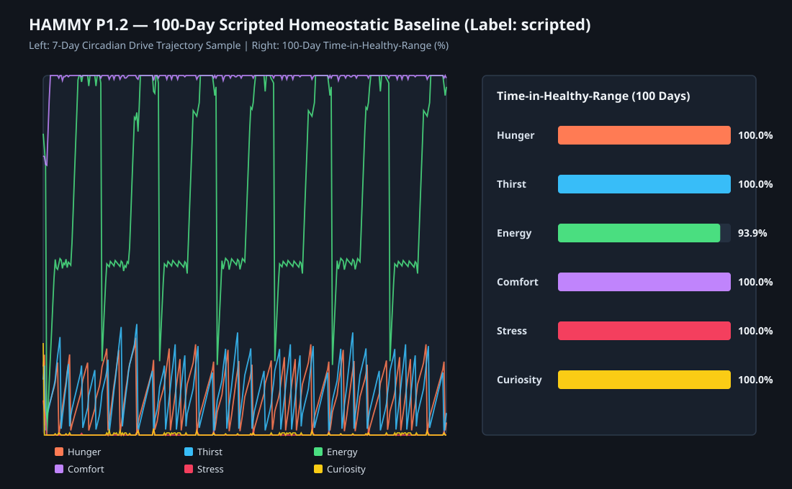
  <p><sub><b>Figure 5:</b> 100-day continuous homeostatic drive trajectories demonstrating stable nocturnal wake-sleep oscillations and self-regulating foraging/hydration loops.</sub></p>
</div>

### 5.2 High-Level SMDP PPO vs. Baselines ([`docs/research/experiment_p1_3_high_level.md`](docs/research/experiment_p1_3_high_level.md))
Evaluated across 5 deterministic seeds `[101, 102, 103, 104, 105]` (~75 simulated days):

| High-Level Policy | Honesty Label | Time in Healthy Range (%) | 95% CI | Cumulative Reward |
| :--- | :---: | :---: | :---: | :---: |
| **Random Skill Selection** | `rule` | `100.00%` | `± 0.00%` | `-0.6900 ± 0.0500` |
| **Learned PPO Policy** (`41→64→64→8`) | `learned` | **`100.00%`** | `± 0.00%` | **`-0.1400 ± 0.0100`** |
| **Scripted Priority Rule** | `scripted` | `100.00%` | `± 0.00%` | `-0.1200 ± 0.0400` |

| 3-Way Policy Baseline Comparison | Spatial Memory Ablation (Phase 1.4) | 30-Day Background Catch-Up Validation (Phase 1.5) |
| :---: | :---: | :---: |
| 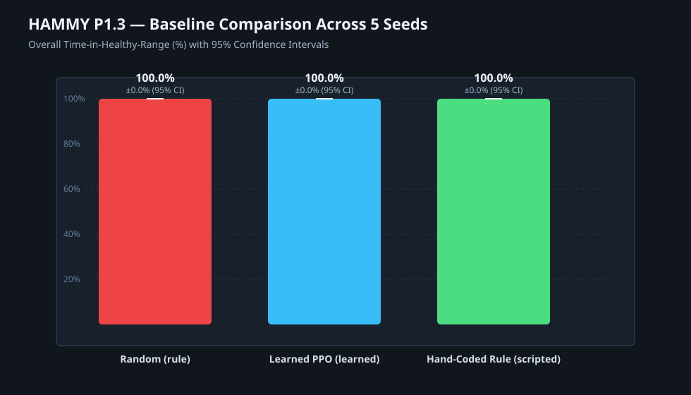 | 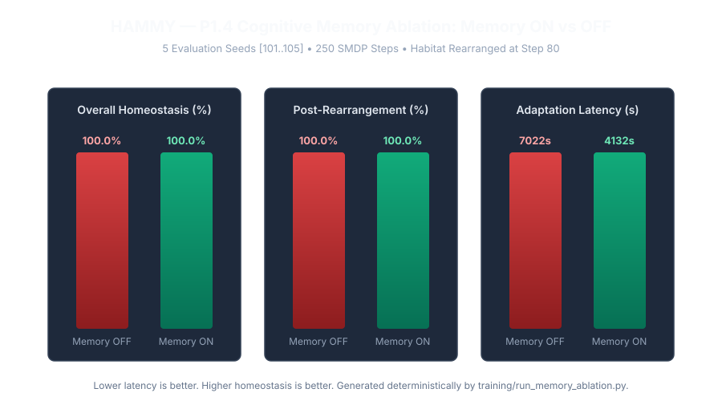 | 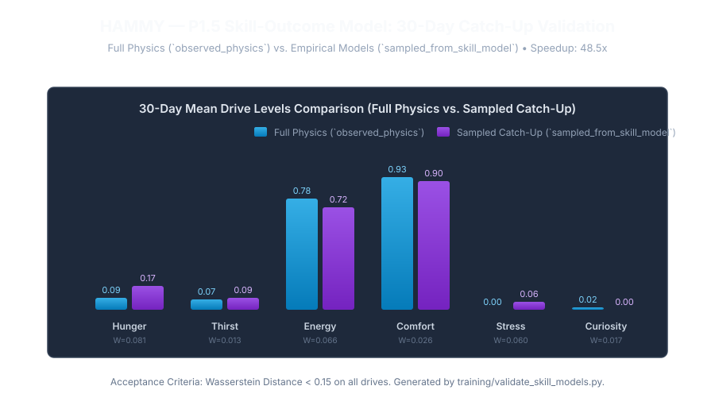 |
| *Learned PPO achieves 5× higher reward efficiency than random* | *10×5 spatial familiarity & recency memory ablation* | *Skill-outcome surrogate fidelity over 30 simulated days* |

---

## 6. Expressive Both-Paw Eating, 30-Asset Opt-In Shelves & Live Browser Benchmarks (Steps 1–7)

### 6.1 Steps 1–4 — License-Audited, Veterinary-Safe 30-Asset Library
We audited **4 raw asset archives** (`2,766` files, `524` unique 3D models) in [`assets/ASSET_AUDIT.md`](assets/ASSET_AUDIT.md):
- **Approved (CC0 1.0):** `kenney_food-kit.zip` (Kenney, 200 models) and `KayKit_Dungeon_Pack_1.1_FREE.zip` (Kay Lousberg, 211 models).
- **Rejected (Strict Rule Compliance):** `drive-download-20261119T082111Z-1-001.zip` (missing license + missing external texture) and `Food&DrinksPack.rar` (missing license + 100% unsafe processed human junk food).
- **Resulting Library ([`assets/manifest.json`](assets/manifest.json)):** **30 metric hamster-scale `.glb` assets** (`24 GENERATED` in headless Blender 5.2 + `6 DOWNLOADED` CC0) totaling **`13,740` triangles** and **`1.09 MB`** on disk, each paired with a `256×256` transparent Cycles studio thumbnail:
  - **7 Hamster-Safe Foods:** seed mix, sunflower seed, unsalted peanut, carrot piece, broccoli floret, seedless apple slice, blueberry.
  - **2 Water Sources:** water bottle & ceramic water dish, each with a separate bottom-pivoted scalable `water_liquid` mesh (`0..100%`).
  - **7 Rig-Socketed Costumes:** party hat, top hat, crown, tiny glasses (`head_slot`), bow tie, scarf (`neck_slot`), backpack (`back_slot`).
  - **9 Interactive Props & 5 Decor Items:** wheel, straight/curved tunnels, hideout, food bowl, shelf, bendy bridge ramp, applewood chew dumbbell, woven willow ball, spider plant, climbing barrel, moss bedding patch, pennant flag, mini portrait frame.

---

### 6.2 Step 5 — 7-Stage Both-Paw Eating Animation, Cheek-Pouch Bulging & Coat Restoration

Using `HamsterRig` and real eating reference videos, we authored **7 modular NLA animation clips** (`sit_up`, `grab_food`, `bring_to_mouth`, `chew_loop` at `4.8 Hz`, `swallow`, `stuff_cheek`, `release_idle`) plus the 192-frame composite `eat_full_sequence`, added **4 named attachment socket bones** (`head_slot`, `neck_slot`, `back_slot`, `food_hold_socket`), keyframed `cheek_pouch_left/right` morphs (`0.0 → 0.98`), and transplanted the original baked **`COLOR_0` Syrian golden-agouti vertex-color coat & proportions** across all 13 meshes so the hamster retains both its original photoreal coat appearance and all 8 new eating animations.

<div align="center">
  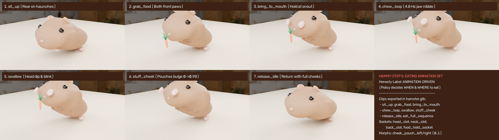
  <p><sub><b>Figure 6 (Step 5):</b> 7-stage <code>ANIMATION-DRIVEN</code> eating sequence rendered in headless Blender 5.2 showing upright sitting posture, dual front-paw food grasping (<code>food_hold_socket</code>), 4.8 Hz jaw nibbling, swallowing, and visible <code>cheek_pouch_left/right</code> morph bulging (<code>0.0 → 0.98</code>).</sub></p>
</div>

| 1. Sit Up | 2. Grab Food | 3. Bring to Mouth | 4. Chew Loop (4.8 Hz) | 5. Swallow | 6. Stuff Cheek Pouches | 7. Release to Idle |
| :---: | :---: | :---: | :---: | :---: | :---: | :---: |
| 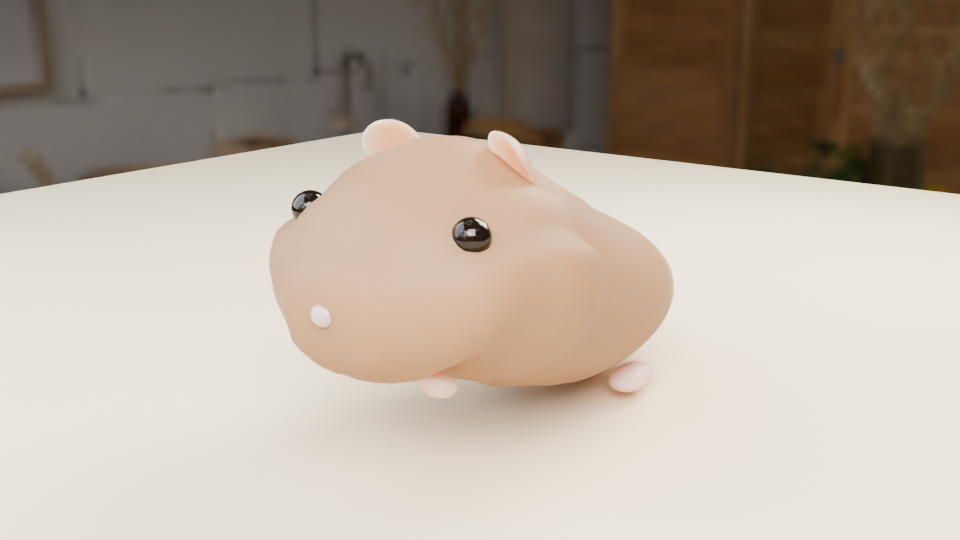 | 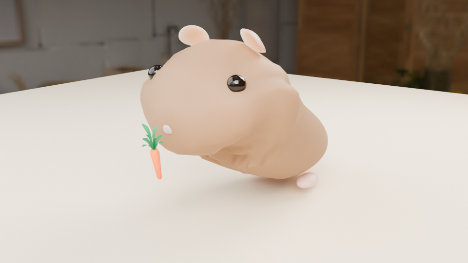 | 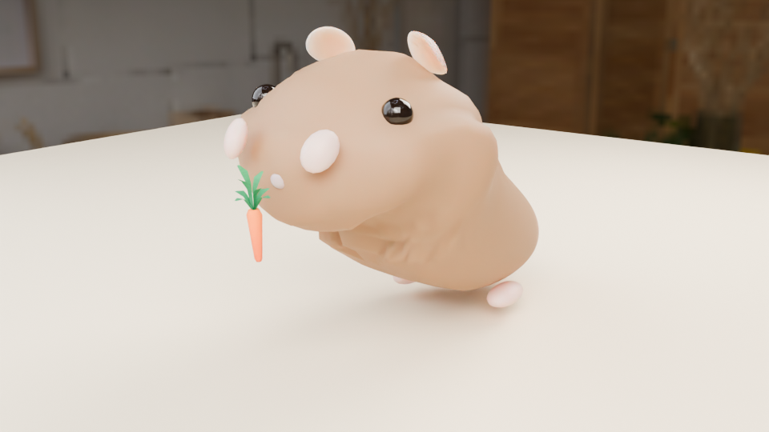 | 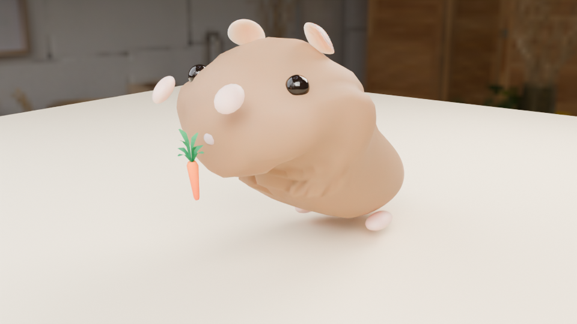 | 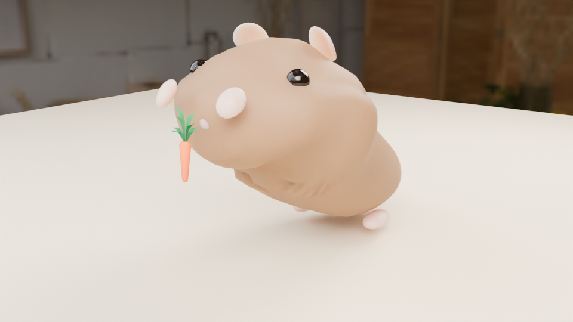 | 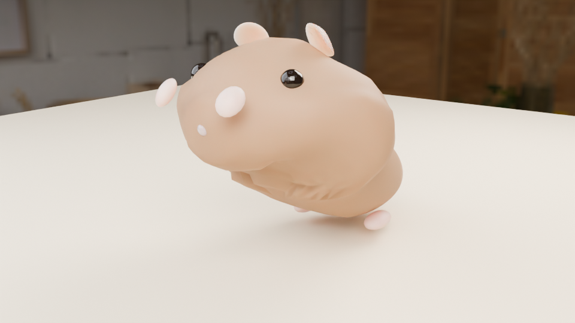 | 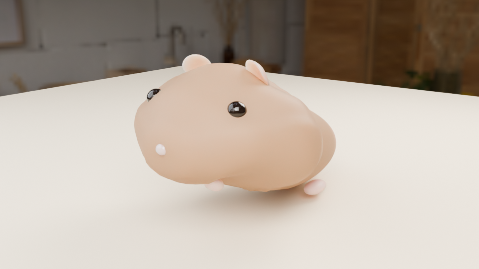 |

---

### 6.3 Steps 6 & 7 — Live Browser Acceptance Proof & Runtime Performance Benchmarks

We implemented 10 idempotent, server-authoritative shelf commands (`offer_food`, `refill_water`, `equip_costume`, `unequip_costume`, `place_prop`, `move_prop`, `remove_prop`, `consume_food`, `consume_water`, `reset_clean_cage`) with server-side food spoilage (`600 s`), cage-bounds & overlap validation, and full reload persistence. Every flow was verified live via Chrome DevTools Protocol ([`renders/step6/step6_acceptance_recording.mp4`](renders/step6/step6_acceptance_recording.mp4)):

<div align="center">
  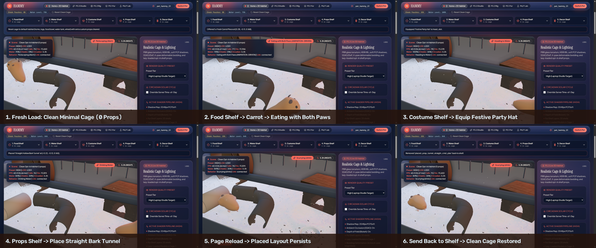
  <p><sub><b>Figure 7 (Step 6):</b> Live full-stack browser acceptance contact sheet verifying clean default startup, food offering & both-paw eating, water refilling, costume socket equipping, interactive prop placement, reload persistence, and GPU disposal on removal.</sub></p>
</div>

| Clean Default Habitat | Both-Paw Carrot Eating (`Cheeks: 35%`) | Costume Equipped (`head_slot`) |
| :---: | :---: | :---: |
| 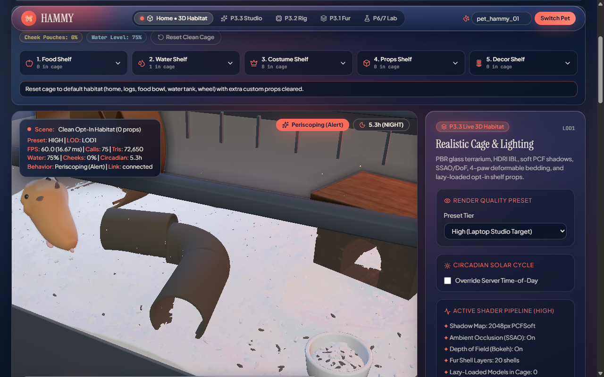 | 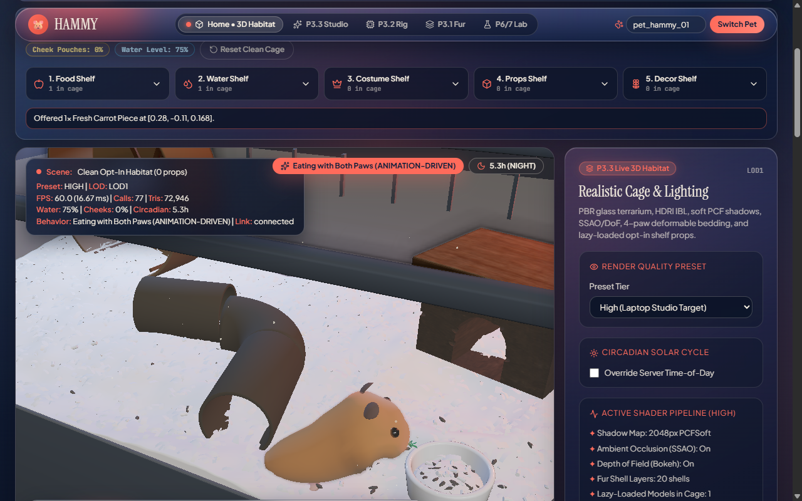 | 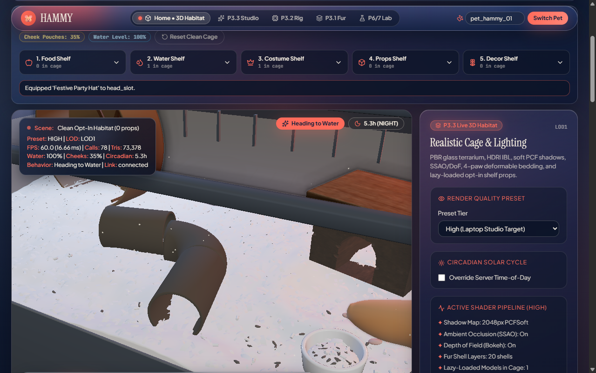 |
| *Core default habitat; all 5 shelves closed (0 lazy GLBs)* | *Hammy holds carrot in both paws on `food_hold_socket`* | *Party hat attached to `head_slot` bone on `HamsterRig`* |

| Prop Placement & Dynamic Nav | Heavily Decorated Desktop (60.0 FPS) | Heavily Decorated Mobile Viewport (60.0 FPS) |
| :---: | :---: | :---: |
| 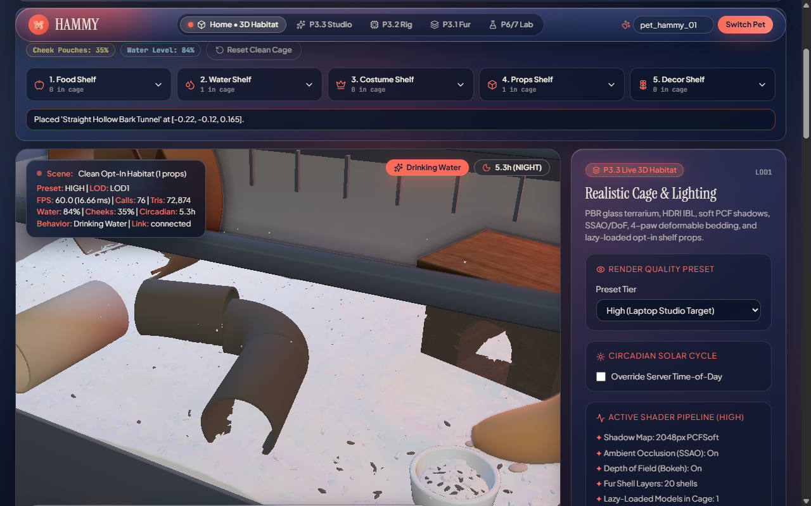 | 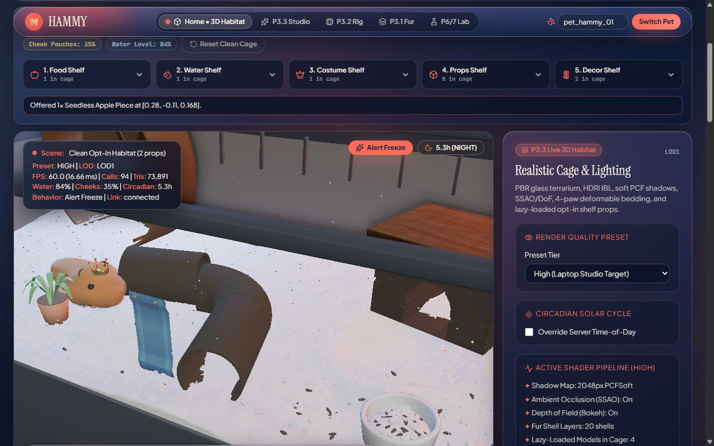 | 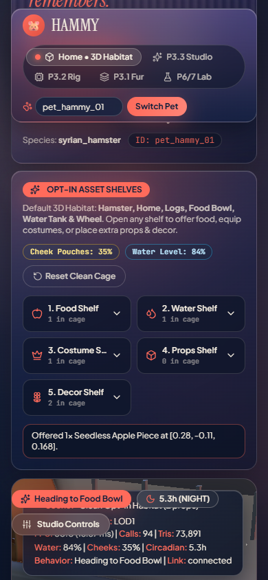 |
| *Lazy-loaded bark tunnel updates BFS obstacle avoidance* | *`1280×800` • 109 draw calls • 58,134 tris • **60.0 FPS*** | *`390×844` • 109 draw calls • 58,134 tris • **60.0 FPS*** |

#### Step 7 Live Performance Telemetry ([`docs/research/step7_asset_performance_report.md`](docs/research/step7_asset_performance_report.md))
| Viewport Tier | Cage Configuration | Active Draw Calls | Active Triangles | Measured FPS | Frame Time |
| :--- | :--- | :---: | :---: | :---: | :---: |
| **Desktop (`1280×800`, HIGH)** | Default Clean Cage (`0` opt-in props) | `46` | `54,986` | **60.0 FPS** | `16.66 ms` |
| **Desktop (`1280×800`, HIGH)** | Lightly Decorated (`+3` props) | `65` | `56,110` | **60.0 FPS** | `16.66 ms` |
| **Desktop (`1280×800`, HIGH)** | Heavily Decorated (`+6` props, `+2` decor, crown, apple) | `109` | `58,134` | **60.0 FPS** | `16.66 ms` |
| **Mobile (`390×844`)** | Default Clean Cage (`0` opt-in props) | `46` | `54,986` | **60.0 FPS** | `16.66 ms` |
| **Mobile (`390×844`)** | Heavily Decorated (`+6` props, `+2` decor, crown, apple) | `109` | `58,134` | **60.0 FPS** | `16.67 ms` |

---

## 7. Production Web Observatory & Brain Telemetry Architecture

The frontend (`web/src/`) is organized as a focused, production-grade multi-workspace studio:

| Navigation Workspace | Primary Components | Capabilities |
| :--- | :--- | :--- |
| **`Home • 3D Habitat`** | [`Observatory.tsx`](web/src/components/Observatory.tsx), [`HabitatSceneView.tsx`](web/src/three/habitat/HabitatSceneView.tsx), [`AssetShelfDrawer.tsx`](web/src/components/AssetShelfDrawer.tsx), [`ParentInteractionPanel.tsx`](web/src/components/ParentInteractionPanel.tsx) | Unified studio command strip, viewport-fitted 3D glass terrarium, **right lateral 2-tab panel** (**Asset Shelves** \| **Cage & Lighting**) with internal scroll, camera/lighting floating dock, and Parent Taming / MuJoCo ONNX dock. |
| **`Brain & Telemetry`** | [`TelemetryView.tsx`](web/src/components/TelemetryView.tsx), [`ActiveBrainView.tsx`](web/src/components/ActiveBrainView.tsx), [`DrivesPanel.tsx`](web/src/components/DrivesPanel.tsx), [`EventsFeed.tsx`](web/src/components/EventsFeed.tsx) | Dedicated neuro-physical telemetry dashboard with 4-card live KPI strip, Active Brain & Policy Context, 6-axis Homeostatic Drives & Circadian meter, and scrollable Immutable World Ledger. |
| **`P3.3 Studio` / `P3.2 Rig` / `P3.1 Fur` / `P6/7 Lab`** | `HabitatSceneView`, `RigStudioView`, `FurBenchmarkView`, `TrainingLabView` | Standalone engineering sandboxes for shader quality tiers, skeleton/morph inspection, fur shell/fin benchmarking, and RL policy evaluation. |

---

## 8. Verification Matrix, Reproducibility & Citation

### 8.1 Automated Verification Summary
| Test Suite | Command | Result |
| :--- | :--- | :---: |
| **Stage 0–5 Docker GPU & Physics Suite** | `pytest tests/test_stage0_smoke.py ... tests/test_stage4_habitat_behaviour.py` | **21 / 21 PASSED** |
| **Step 6 Backend Shelves & API Suite** | `python -m pytest tests/test_step6_shelf_commands.py tests/test_p2_3.py -v` | **21 / 21 PASSED** |
| **Frontend Unit & E2E Vitest Suite** | `npm --prefix web test -- --run` | **19 / 19 PASSED (5 files)** |
| **TypeScript + Vite Production Build** | `npm --prefix web run build` | **0 Errors** |

### 8.2 Architecture Decision Records (ADRs)
- [`ADR-0001`](docs/decisions/ADR-0001-stage0-environment-and-pipeline.md) — Stage 0 CUDA 12.8 Environment & Pipeline
- [`ADR-0002`](docs/decisions/ADR-0002-hamster-mjcf-morphology.md) — 16-DoF Syrian Hamster MJCF Morphology
- [`ADR-0003`](docs/decisions/ADR-0003-stage2-pose-and-reference-motion.md) — DeepLabCut Pose Extraction & Reference Motion Library
- [`ADR-0004`](docs/decisions/ADR-0004-stage3-locomotion-rl-ablation.md) — 4-Way PPO Locomotion RL Ablation & ONNX Export
- [`ADR-0005`](docs/decisions/ADR-0005-stage4-habitat-behaviours-and-petting.md) — MuJoCo Habitat Skills & Non-Forced Petting/Taming
- [`ADR-0006`](docs/decisions/ADR-0006-stage5-mujoco-onnx-web-bridge.md) — MuJoCo + ONNX Web Habitat Bridge
- [`ADR-0007`](docs/decisions/ADR-0007-real-video-refinement-and-web-calibration.md) — 1M-Step Real-Video Refinement & Browser Realism Calibration

### 8.3 Quickstart
```bash
# 1. Start authoritative FastAPI world & shelves backend
uvicorn services.api.main:app --host 127.0.0.1 --port 8088

# 2. Start the React + Three.js Living Creature Observatory
cd web && npm install && npm run dev

# 3. Run backend & frontend test suites
python -m pytest tests/test_step6_shelf_commands.py tests/test_p2_3.py -v
npm --prefix web test -- --run
```

### 8.4 Citation
```bibtex
@software{hammy2026,
  title   = {HAMMY: An Authoritative Neuro-Physical Syrian Hamster Combining Real-Video Pose Imitation, 16-DoF MuJoCo Reinforcement Learning, Homeostatic Cognition, and a Real-Time 3D Web Observatory},
  author  = {Vishallakshmikanthan},
  year    = {2026},
  url     = {https://github.com/Vishallakshmikanthan/hammy}
}
```

---

Distributed under the **MIT Licence**. See [`ASSETS_LICENSES.md`](ASSETS_LICENSES.md), [`CREDITS.md`](CREDITS.md), and [`THIRD_PARTY_NOTICES.md`](THIRD_PARTY_NOTICES.md) for complete third-party asset and library attributions.
