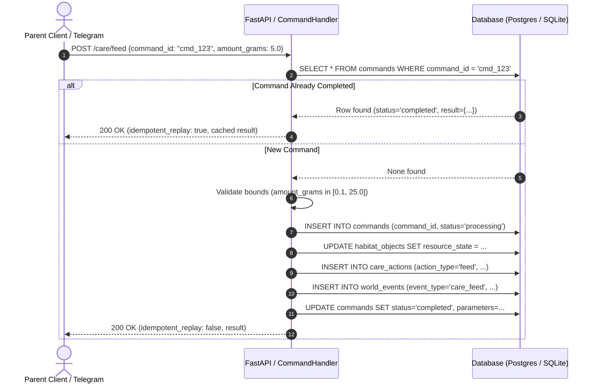

# HAMMY — Parent API & Command Architecture (P2.3)

## 1. Overview & Service Blueprint

The **HAMMY Parent API** (`services/api`) is a high-performance REST and WebSocket service built on FastAPI. It provides the authoritative communication interface for user clients (Web, Observatory, and Mobile) and external interfaces (Telegram Bot via `services/commands`).

### Core Guarantees:
- **Authentication & Multi-Tenant Authorization:** JWT token validation against Supabase auth; every pet-scoped route validates pet ownership via `verify_pet_access`.
- **Command Idempotency (Rule 4):** Every mutating action requires a client-generated `command_id`. Duplicate submissions return cached outcomes without re-applying mutations (e.g. feeding twice with identical `command_id` adds food exactly once).
- **Decoupled Command Handlers:** The command logic in `services/commands/handler.py` is shared between the HTTP API and the Telegram Bot, preventing divergence in game rules.
- **Real-Time Streaming:** WebSocket endpoint `/api/v1/pets/{pet_id}/ws` pushes state snapshots and event notifications.
- **Rate Limiting:** Sliding-window rate limiting per client to guard against abusive polling or rapid command spam.

---

## 2. API Endpoints Blueprint

| Method | Path | Auth Required | Description |
| :--- | :--- | :--- | :--- |
| `GET` | `/api/v1/pets/{pet_id}` | Bearer JWT | Returns core pet identity, morphology, and birthdate. |
| `GET` | `/api/v1/pets/{pet_id}/state` | Bearer JWT | Returns live simulation state, drives, pose, and pause state. |
| `GET` | `/api/v1/pets/{pet_id}/events` | Bearer JWT | Returns recent append-only world events (supports `limit`, `since_tick`). |
| `GET` | `/api/v1/pets/{pet_id}/memories` | Bearer JWT | Returns cognitive memory records (object appraisals & spatial grid). |
| `GET` | `/api/v1/pets/{pet_id}/habitat` | Bearer JWT | Returns habitat enclosure dimensions and floor boundaries. |
| `GET` | `/api/v1/pets/{pet_id}/habitat/objects`| Bearer JWT | Lists all interactive props, poses, and resource states. |
| `POST`| `/api/v1/pets/{pet_id}/habitat/objects`| Bearer JWT | Moves an object (`command_id`, `object_id`, `new_pose_xyz_m`). |
| `POST`| `/api/v1/pets/{pet_id}/care/feed` | Bearer JWT | Adds food to the habitat bowl (`command_id`, `amount_grams`). |
| `POST`| `/api/v1/pets/{pet_id}/care/water` | Bearer JWT | Refills water bottle (`command_id`, `amount_ml`). |
| `POST`| `/api/v1/pets/{pet_id}/enrichment` | Bearer JWT | Adds enrichment item (`command_id`, `enrichment_type`, `parameters`). |
| `POST`| `/api/v1/pets/{pet_id}/simulation/pause` | Bearer JWT | Pauses temporal advancement for the pet (`command_id`). |
| `POST`| `/api/v1/pets/{pet_id}/simulation/resume`| Bearer JWT | Resumes temporal advancement (`command_id`). |
| `GET` | `/api/v1/system/health` | None | Returns operational health status and database connectivity. |
| `WS`  | `/api/v1/pets/{pet_id}/ws` | Token Query | Real-time bi-directional WebSocket connection. |

---

## 3. Idempotent Command Processing Flow



---

## 4. Shared Command Layer (`services/commands`)

The `CommandHandler` class is instantiated as a shared service across both API route controllers and the Telegram bot worker (`services/world_worker` and `services/notification_worker`).
- **Validation:**
  - `feed`: `0.1 <= amount_grams <= 25.0`
  - `water`: `1.0 <= amount_ml <= 150.0`
  - `enrichment`: type in `["chew_toy", "cardboard_tube", "foraging_scatter", "sprig", "tunnel_extension"]`
  - `move_object`: new pose coordinates checked against habitat `floor_bounds`
- **Audit Logging:** Every command records a row in `commands`, creates a `CareAction` row with foreign key linkage, and logs an immutable `WorldEvent`.

---

## 5. Real-Time WebSocket Protocol

- **Endpoint:** `GET /api/v1/pets/{pet_id}/ws?token=<bearer_jwt>`
- **Handshake:** Validates token and checks pet ownership. Closes with code 4001/4003 on failure.
- **Initial Payload:**
  ```json
  {
    "type": "snapshot",
    "pet_id": "pet_hammy_01",
    "version": 4,
    "sim_time_sec": 3600.0,
    "drives": {
      "hunger": 0.22,
      "thirst": 0.18,
      "energy": 0.75,
      "comfort": 0.88,
      "stress": 0.12,
      "curiosity": 0.40,
      "circadian_phase": 0.65
    },
    "position_xyz": [0.12, -0.05, 0.165],
    "is_paused": false
  }
  ```
- **Heartbeat:** Supports client `"ping"` receiving text `"pong"`.

