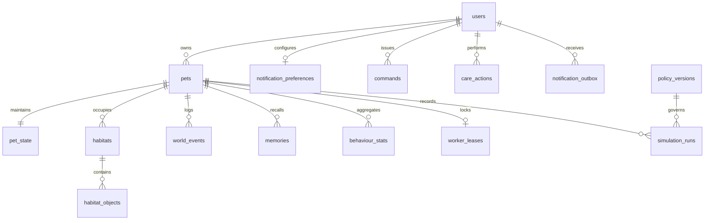

# HAMMY — Database Architecture & Relational Schema (P2.1)

## 1. Overview & Strategy

The HAMMY persistence layer provides relational storage, append-only event sourcing, and concurrency control across the virtual pet lifecycle. It is designed to support:
- **Supabase / PostgreSQL (Production & Staging):** Primary engine leveraging `JSONB` for vector states, foreign-key cascades, PL/pgSQL immutability triggers, and Row-Level Security (RLS) for tenant isolation.
- **SQLite (Development & Automated CI/Testing):** In-memory and local file engine enabling fast, deterministic tests without external daemon dependencies.
- **Alembic & Raw SQL DDL:** Standardized versioned migrations alongside standalone DDL scripts for automated environment provisioning.

---

## 2. Relational Schema: 16 Core Tables



### Table Specifications

| Table Name | Primary Key | Key Relationships / Indices | Purpose |
| :--- | :--- | :--- | :--- |
| `users` | `id` (VARCHAR 64) | `email` (UNIQUE, INDEX) | Represents pet owners, mapping 1:1 to Supabase `auth.users.id`. |
| `pets` | `id` (VARCHAR 64) | `user_id` (FK `users.id`), INDEX | Stores core pet identities, species, and morphology versions. |
| `pet_state` | `pet_id` (VARCHAR 64) | FK `pets.id`, `version` | Current simulation snapshot with monotonic version counter for optimistic concurrency. |
| `habitats` | `id` (VARCHAR 64) | `pet_id` (FK `pets.id`), INDEX | Physical enclosure dimensions and metadata. |
| `habitat_objects` | `id` (VARCHAR 64) | `habitat_id` (FK `habitats.id`), INDEX | Interactive props (food bowl, water bottle, hideout, wheel, tunnel, chew block). |
| `care_actions` | `id` (VARCHAR 64) | `user_id`, `pet_id`, INDEX | Records care interactions (refill food, clean habitat, petting). |
| `world_events` | `event_id` (VARCHAR 128) | `pet_id`, `sim_time_sec`, INDEX | Append-only event stream recording physics and model outcomes. Immutability enforced by trigger. |
| `memories` | `id` (VARCHAR 64) | `pet_id`, `target_id`, INDEX | Object appraisals and spatial familiarity grid representations. |
| `behaviour_stats` | `id` (VARCHAR 64) | `pet_id`, INDEX | Periodic rollups of skill distributions, drive means, and activity. |
| `policy_versions` | `id` (VARCHAR 64) | Unique policy ID | Checkpoints and metrics for PPO and scripted policies. |
| `simulation_runs` | `id` (VARCHAR 64) | `pet_id`, `policy_version_id`, INDEX | Log of physics steps, wall-clock duration, and catch-up performance. |
| `training_runs` | `id` (VARCHAR 64) | `experiment_name`, INDEX | RL training telemetry, step counts, and final mean rewards. |
| `notification_preferences` | `user_id` (VARCHAR 64) | FK `users.id` | Telegram chat ID, quiet hours, and digest schedules. |
| `notification_outbox` | `id` (VARCHAR 64) | `user_id`, `pet_id`, `status`, INDEX | Outbox queue for outgoing Telegram alerts and digests. |
| `worker_leases` | `pet_id` (VARCHAR 64) | FK `pets.id`, `expires_at`, INDEX | Distributed mutual exclusion lease for simulation worker instances. |
| `commands` | `command_id` (VARCHAR 128) | PK, `pet_id`, `user_id`, `status`, INDEX | Ingestion command log enforcing idempotency keys (Rule 4). |

---

## 3. Idempotency & Immutability Enforcement

### 3.1 Mandatory Command Idempotency (Rule 4)
All user and system commands use client-generated idempotency keys as the table primary key (`commands.command_id`). Duplicate insertions fail immediately with database-level uniqueness violation (`IntegrityError`), preventing duplicate actions.

### 3.2 Append-Only Event Log (Rule 2 & Acceptance Criterion 3)
The `world_events` table is strictly append-only. To prevent accidental modification or tampering, database triggers are deployed:
- **PostgreSQL / Supabase:** PL/pgSQL function `prevent_world_events_update_func()` attached via `BEFORE UPDATE ON world_events`, raising an exception.
- **SQLite:** `CREATE TRIGGER prevent_world_events_update BEFORE UPDATE ON world_events BEGIN SELECT RAISE(ABORT, '...'); END;`.

---

## 4. Concurrency Control Architecture

### 4.1 Optimistic Concurrency on `pet_state`
Simulation updates increment an atomic monotonic `version` counter:
```sql
UPDATE pet_state
SET version = version + 1,
    sim_time_sec = :new_time,
    last_simulated_at = NOW(),
    drives = :new_drives
WHERE pet_id = :pet_id AND version = :expected_version;
```
If 0 rows are updated, a concurrency conflict is detected and the worker reloads state.

### 4.2 Distributed Mutual Exclusion with `worker_leases`
To guarantee only one worker process advances a pet's simulation at any given time, workers acquire leases with TTL (`expires_at`) using CAS (compare-and-swap) updates on `worker_leases.version`.

---

## 5. Supabase Row-Level Security (RLS)

All user-facing tables enable RLS to enforce strict multi-tenant isolation:
- `users`: User can only view and update their own record (`auth.uid()::text = id`).
- `pets`: User can only access pets where `pets.user_id = auth.uid()::text`.
- `pet_state`, `habitats`, `world_events`: Enforce access through subquery ownership validation (`EXISTS (SELECT 1 FROM pets WHERE pets.id = ... AND pets.user_id = auth.uid()::text)`).
- `commands`: Enforce command sender matches `auth.uid()`.
- **Worker / Background Service:** Simulation daemons connect using the Supabase `service_role` key, which bypasses RLS policies to perform catch-up runs and write world events.

---

## 6. Seed & Migration Pipeline

- **Alembic:** Initial revision `infrastructure/database/alembic/versions/0001_initial_schema.py` applies all 16 tables and sets up database triggers.
- **Seed Script (`infrastructure/database/seeds.py` & `seed.sql`):** Populates:
  - 1 User: `usr_hammy_default` (`owner@hammy.local`)
  - 1 Pet: `pet_hammy_01` ("Hammy")
  - 1 PetState: initial healthy drives, origin pose `[0.0, 0.0, 0.165]`
  - 1 Habitat: `habitat_v1_main`
  - 6 Standard Habitat Objects: `prop_bowl_main`, `prop_bottle_main`, `prop_hideout_main`, `prop_tunnel_main`, `prop_wheel_main`, `prop_chew_block_main`
  - 1 Notification Preference: Telegram notifications enabled with default quiet hours

