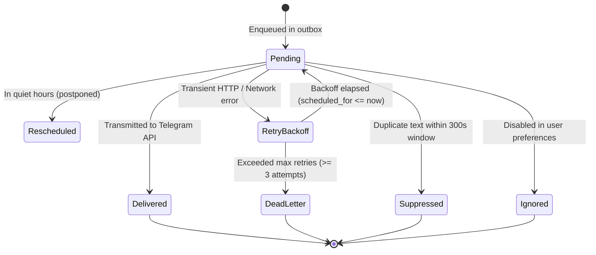
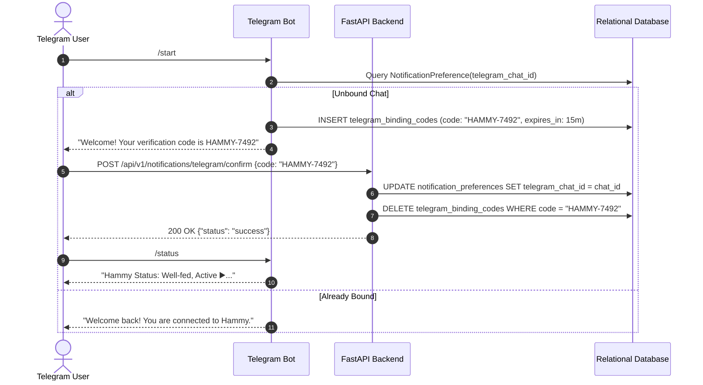

# HAMMY — Telegram Bot & Notification Outbox Architecture (P2.4)

## 1. Overview & Service Architecture

The **Telegram Integration & Notification Outbox** (`services/notification_worker`) delivers asynchronous alerts, daily digests, and conversational command controls to parents.

### Core Guarantees:
- **Outbox Pattern:** World simulation workers write notifications directly into the `notification_outbox` table during their atomic state transaction. They never make synchronous external HTTP calls to Telegram, ensuring that Telegram outages or rate limits cannot block simulation advancement (Criterion 7).
- **At-Least-Once to Exactly-Once Delivery:** The worker executes exponential backoff retries on transient failures and enters a `dead_letter` state upon exceeding retry thresholds. Duplicate suppression ensures duplicate identical messages within the suppression window (300s) are suppressed (Criterion 7 & 5).
- **Secure Chat Binding Flow:** Unbound chats typing `/start` receive a 6-character one-time verification code (e.g. `HAMMY-XXXX`) that must be confirmed by the parent on the website (`POST /api/v1/notifications/telegram/confirm`). All commands from unbound chats are rejected (Criterion 2).
- **Shared Command Layer:** Bot commands (`/status`, `/feed`, `/water`, `/pause`, `/resume`, `/report`) strictly invoke `services/commands/handler.py` and never mutate the database directly (Criterion 3).
- **Daily Digest with Plain-Language Provenance (Rule 1, 2, 4):** Daily digests are constructed solely from recorded `world_events` and explicitly translate origin enum values into plain language (e.g., "Predicted by behavioral AI model", "Simulated in full 3D physics", "Care action / Game rule") (Criterion 4).
- **Token Security (Rule 8):** `TELEGRAM_BOT_TOKEN` is loaded solely from environment variables; live credentials are never committed.

---

## 2. Notification Outbox Lifecycle & State Transitions



---

## 3. Chat Binding & Verification Flow



---

## 4. Bot Commands & Shared Command Dispatch

All commands execute through the decoupled `CommandHandler` in `services/commands/handler.py`:
- `/status`: Inspects pet age, drives, temporal state, and active skill.
- `/feed [grams]`: Feeds pet (default 5.0g, max 25.0g). Generates client idempotency key; duplicate commands are safely replayed.
- `/water [ml]`: Refills water bottle (default 20.0ml, max 150.0ml).
- `/pause`: Pauses temporal advancement.
- `/resume`: Resumes temporal advancement.
- `/report`: Generates on-demand daily activity digest.

---

## 5. Daily Digest Format Example

```text
🐹 Hammy's Daily Activity Digest
Period: Nov 13, 09:00 – Nov 14, 09:00 UTC

📊 Activity Breakdown (from recorded events):
• Total events recorded: 24
• Eating meals: 6
• Water bottle drinks: 4
• Wheel running sessions: 5
• Burrow/hideout resting: 8
• Cage explorations: 1
• Parent care interactions: 2

🧬 Event Provenance (Honesty Rules):
• Predicted by behavioral AI model: 20 events
• Simulated in full 3D physics: 2 events
• Care action / Game rule: 2 events

❤️ Current Physiological Status:
• Hunger: 18%
• Thirst: 15%
• Energy: 82%
• Comfort: 90%
• Stress: 10%
```

