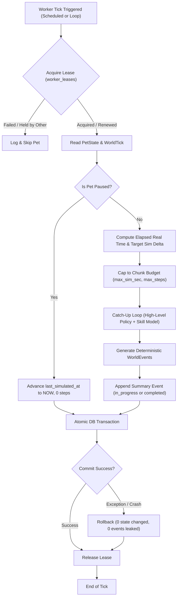

# HAMMY — Persistent World Worker Architecture (P2.2)

## 1. Overview & Operational Model

The **World Worker** (`services/world_worker`) is the persistent daemon responsible for advancing the background lives of Syrian hamsters when the interactive 3D client is disconnected. It guarantees:
- **Distributed Single-Writer Exclusion:** Through optimistic mutual exclusion leases (`worker_leases`).
- **Bounded Catch-Up Execution:** Slices arbitrarily long real-time offline gaps (e.g., 7–30 days) into capped simulation chunks so execution time is strictly bounded per tick.
- **Honesty & Origin Contracts (Rules 1 & 2):** Every background skill outcome is sampled via the empirical model (`ai/cognition/skill_outcome_model.py`) and explicitly tagged with `origin = sampled_from_skill_model` and `behaviour_type = scripted`.
- **Deterministic Event Deduplication (Rule 4):** Event IDs are cryptographically derived from `(pet_id, world_tick, event_type, seed)`, guaranteeing idempotent retries without phantom duplicate events.
- **Atomic Transactions:** State mutations and event writes succeed together or rollback completely on process failure or database exception.

---

## 2. World Worker Lifecycle Workflow

---

## 3. Distributed Lease Management (`worker_leases`)

Mutual exclusion is enforced per pet via `worker_leases` using atomic compare-and-swap (CAS):
1. **Acquisition:**
   - If no lease exists: inserted with `version = 1` and `expires_at = now + ttl_sec`.
   - If existing lease is unexpired and belongs to another worker: acquisition is rejected (`lease_unavailable`).
   - If existing lease is expired (`expires_at <= now`): taken over atomically by incrementing `version = version + 1`.
2. **Renewal:** An active owner extends `expires_at` periodically.
3. **Release:** Sets `expires_at` into the past immediately, allowing immediate handover.

---

## 4. Bounded Catch-Up Simulation & Summary Events

When a pet has been offline for a long period (e.g. 7 days = 604,800s):
- **Real-Time Mapping:** `target_sim_sec = elapsed_real_sec * real_time_scale`.
- **Chunk Capping:** Simulation steps execute up to `max_sim_sec_per_run` (e.g., 3,600s) and `max_steps_per_run` (e.g., 50 skills).
- **Proportional Real-Time Progression:**
  $$\text{real\_sec\_consumed} = \frac{\text{simulated\_sec}}{\text{real\_time\_scale}}$$
  $$\text{new\_last\_simulated\_at} = \text{last\_simulated\_at} + \text{real\_sec\_consumed}$$
  The remaining unsimulated real time is accurately preserved for the subsequent worker tick.
- **Summary Events:**
  - If remaining time $> 15.0$s: emits `catch_up_in_progress` with `remaining_sim_sec`, `steps_executed`, and `simulated_sec`.
  - When fully caught up: emits `catch_up_completed`.

---

## 5. Deterministic Event IDs & Idempotency

Event IDs are computed deterministically:
$$\text{token} = \text{pet\_id} : \text{world\_tick} : \text{event\_type} : \text{seed}$$
$$\text{event\_id} = \text{"evt\_"} + \text{pet\_id} + \text{"\_"} + \text{world\_tick} + \text{"\_"} + \text{SHA256(token)[:20]}$$

Because `event_id` is the primary key of `world_events`:
- Identical steps evaluated multiple times produce the exact same ID.
- Duplicate inserts are rejected at the engine level without creating duplicate event history.

---

## 6. Atomic Transaction & Rollback Proof

All state mutations (`pet_state.version`, `pet_state.sim_time_sec`, `pet_state.drives`, `pet_state.position_xyz`) and all generated `WorldEvent`s are committed inside a single transaction.

The test script [test_worker_rollback.py](file:///c:/Users/Lenovo/Downloads/hammy/scripts/test_worker_rollback.py) verifies that a simulated catastrophic worker crash mid-transaction leaves the database 100% clean:
- `pet_state.version` remains unincremented.
- `pet_state.sim_time_sec` remains unchanged.
- Zero orphaned `world_events` are committed.

